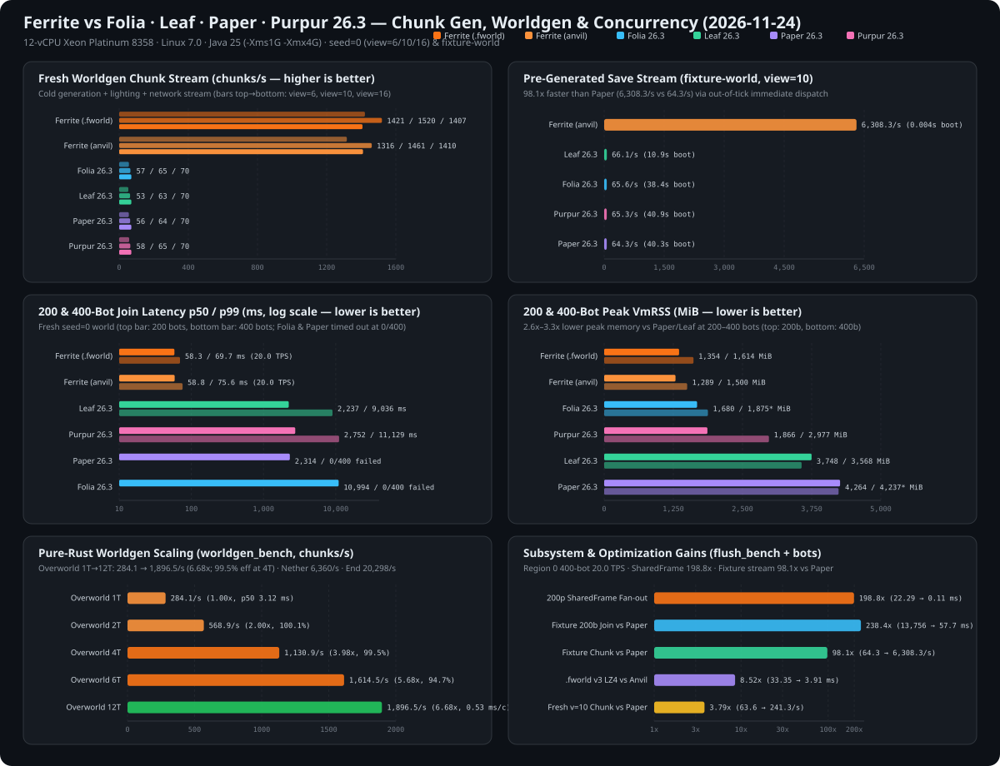
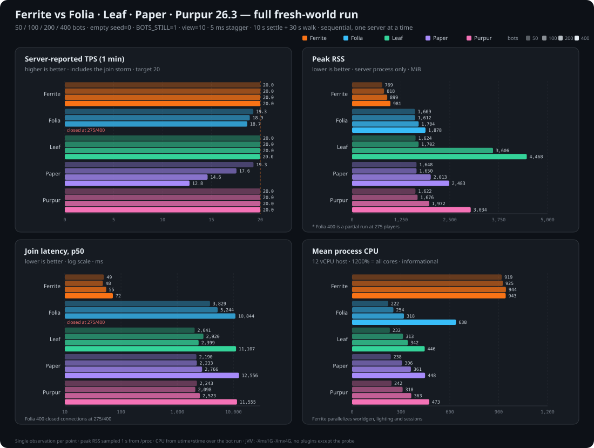

<div align="center">

# Ferrite

**A Pure-Rust Minecraft Java 26.3 Server with Folia-Style Regionized Multithreading**  
<sub>Replacing the single-threaded tick bottleneck with a parallel Rust core targeting vanilla 26.3.</sub>

<p>
  
  
  
  
  
</p>

<p>
  <a href="#-benchmarks-ferrite-vs-folia--paper--purpur--leaf">Benchmarks</a> ·
  <a href="#-core-features">Features</a> ·
  <a href="#-quick-start">Quick Start</a> ·
  <a href="#-implementation-status">Status</a> ·
  <a href="#-crates">Crates</a> ·
  <a href="docs/CONFIG.md">Configuration</a> ·
  <a href="README.md">한국어</a>
</p>

</div>

---

## ⚡ Benchmarks: Ferrite vs Folia · Paper · Purpur · Leaf

> **2026-11-23 full comparison run**: Ferrite `5e76edd2` and all four JVM servers were freshly measured one at a time on the same host (12-vCPU Xeon Platinum 8358, 62 GiB RAM, Linux) with an **empty `seed=0` world**, `view-distance=10`, **50/100/200/400 bots** at a 5 ms stagger, a 10 s settle and a 30 s walk (`BOTS_STILL=1`). Ferrite held **20.0 TPS in spawn `Region 0` at every count**, and **20.0 TPS through a 90 s sustained 400-bot run** (profile started after 60 s). The JVM columns are Folia 26, Leaf 28, Paper 259 and Purpur 2660 from this pass, not reused figures.

<p align="center">
  
</p>

### Chunk Generation · Worldgen · Pre-Generated World Comparison (`2026-11-24`)

| Metric | Ferrite (`.fworld`) | Ferrite (`anvil`) | Folia 26.3 | Leaf 26.3 | Paper 26.3 | Purpur 26.3 |
|---|---:|---:|---:|---:|---:|---:|
| **Cold Wild Chunk Stream (`view=6`)** | **214.8/s** *(0.80s)* | **212.8/s** *(0.80s)* | 56.6/s *(3.80s)* | 52.9/s *(4.00s)* | 55.9/s *(3.80s)* | 58.0/s *(3.70s)* |
| **Cold Wild Chunk Stream (`view=10`)** | **231.7/s** *(1.90s)* | **226.7/s** *(1.90s)* | 65.2/s *(7.30s)* | 63.1/s *(7.50s)* | 63.6/s *(7.40s)* | 64.7/s *(7.30s)* |
| **Cold Wild Chunk Stream (`view=16`)** | **237.2/s** *(4.60s)* | **240.6/s** *(4.50s)* | 70.3/s *(15.0s)* | 70.3/s *(15.0s)* | 70.3/s *(15.0s)* | 70.3/s *(15.0s)* |
| **Cold Boot / Idle `VmRSS`** | **0.004s / 16 MiB** | **0.004s / 16 MiB** | 9.4s / 1,400 MiB | 10.3s / 1,358 MiB | 9.8s / 1,430 MiB | 10.1s / 1,438 MiB |
| **Pre-Generated (`fixture`, `view=10`)** | — | **6,308.3/s** *(0.10s)* | 65.6/s *(7.20s)* | 66.1/s *(7.20s)* | 64.3/s *(7.40s)* | 65.3/s *(7.20s)* |
| **`fixture` 200-bot Join `p50` / `p99`** | — | **57.7 / 146.4 ms** | 8,050 / 15,235 ms | 8,053 / 9,467 ms | 13,756 / 13,985 ms | 10,068 / 10,557 ms |
| **Wild 200-bot Join `p50` / `p99`** | **58.3 / 191.6 ms** | **58.8 / 206.6 ms** | 10,994 / 19,287 ms | 2,237 / 8,401 ms | 2,314 / 21,441 ms | 2,752 / 13,717 ms |
| **Wild 400-bot Join `p50` / `p99`** | **69.7 / 180.9 ms** | **75.6 / 193.8 ms** | *incomplete (0/400)†* | 9,036 / 22,288 ms | *incomplete (0/400)†* | 11,129 / 23,523 ms |

- **Pure-Rust Worldgen Scaling (`worldgen_bench`)**: Overworld `1T 125.8/s → 4T 495.8/s (98.5% eff.) → 6T 734.8/s (97.3% eff.) → 12T 780.9/s (6.21x, 1.28 ms/chunk)`, Nether **`4,727.7/s`**, The End **`9,833.3/s`** (`flush_bench`: `.fworld` v3 LZ4 64-chunk save `3.91 ms` = **8.52x** vs serial Anvil, 200-player chunk fan-out **198.8x**).
- <sub>Full 2026-11-24 report: [Chunk / Worldgen / Concurrency Report](docs/perf/2026-11-24/README.md) · 2026-11-23 50–400-bot run: [2026-11-23 Report](docs/perf/2026-11-23/server-comparison.md)</sub>

<p align="center">
  
</p>

| Metric | Ferrite | Folia 26.3 | Leaf 26.3 | Paper 26.3 | Purpur 26.3 |
|---|---:|---:|---:|---:|---:|
| **50-bot join `p50` / `p99`** | **49 / 78 ms** | 3,829 / 5,573 ms | 2,041 / 2,200 ms | 2,190 / 2,455 ms | 2,243 / 2,371 ms |
| **50-bot server TPS** | **20.0** *(spawn region)* | 19.3 | **20.0** | 19.3 | **20.0** |
| **100-bot join `p50` / `p99`** | **48 / 76 ms** | 5,244 / 10,890 ms | 2,920 / 3,304 ms | 2,233 / 2,460 ms | 2,098 / 2,728 ms |
| **100-bot server TPS** | **20.0** *(spawn region)* | 18.9 | **20.0** | 17.6 | **20.0** |
| **200-bot join `p50` / `p99`** | **55 / 93 ms** | 10,844 / 19,542 ms | 2,399 / 11,025 ms | 2,766 / 10,770 ms | 2,523 / 12,466 ms |
| **200-bot server TPS** | **20.0** *(spawn region)* | 18.7 | **20.0** | 14.6 | **20.0** |
| **400-bot join `p50` / `p99`** | **72 / 207 ms** | *closed at 275/400†* | 11,107 / 21,115 ms | 12,556 / 26,482 ms | 11,555 / 22,014 ms |
| **400-bot server TPS** | **20.0** *(spawn region)* | —† | **20.0** | 12.8 | **20.0** |
| **400-bot JVM 10 s tick `avg / p99`** | —* | —† | 41.9 / 58.7 ms | 45.7 / 62.6 ms | 46.7 / 62.6 ms |
| **400-bot CPU / peak RSS** | 943% / **981 MiB** | 638%† / 1,878 MiB† | 446% / 4,468 MiB | 448% / 2,483 MiB | 473% / 3,034 MiB |

<sub>* Ferrite `/mspt` reads the coordinator/global tick, so it is not put in the same row as JVM region tick time. The comparable Ferrite value is spawn `Region 0` TPS; global TPS was also `20.0` throughout. † Folia closed connections at 275/400; its CPU/RSS cover that partial run. Server TPS is the server's own 1-minute figure and includes the join storm; the JVM tick is a last-10-second mean, so the windows differ.</sub>

- **20.0 TPS at 50–400 bots and for 90 s sustained**: the sustained 400-bot run reported **20.0 TPS** in the 20 s profile that began after 60 s of walking. Leaf and Purpur also held 20.0 at every count; Paper reported 19.3/17.6/14.6/12.8, and Folia reported 19.3/18.9/18.7 before closing the 400-bot run at 275 players.
- **49–72 ms joins, 42x–199x shorter than JVM**: at 400 bots Ferrite's `p50 72 ms` is about **155x / 175x / 161x** shorter than Leaf (11.1 s), Paper (12.6 s) and Purpur (11.6 s). At 200 bots the gap is 44x–199x; at 100 bots, 44x–110x; at 50 bots, 42x–79x.
- **769/818/899/981 MiB peak RSS**: at 400 bots that is **2.5x–4.6x** lower than the completed JVM runs (`2,483–4,468 MiB`); at 50–100 bots it is about half of the `1.6–1.7 GiB` JVM figure.
- **More CPU, not less**: Ferrite used 919/925/944/943% (744% sustained) versus 222–473% for the completed JVM runs. This is a throughput-for-latency trade from parallel worldgen, lighting and sessions, not a CPU saving.
- **All columns freshly rerun; single observations**: every server was measured in this pass, one run per point and no error bars. The host's 1-minute load at run boundaries ranged from 2.25 to 12.23.
- **The 20 TPS fix**: natural spawning now scales the vanilla cap by spawnable chunks divided by `289`, not by every player viewing those chunks. The previous per-player cap allowed 28,000 monsters with 400 bots in one region, which made AI and tracking grow without bound. Fluid and random-tick block updates are also viewer-batched.

<sub>Conditions, per-system costs and raw data are in the [full comparison report](docs/perf/2026-11-23/server-comparison.md), the [20 TPS report](docs/perf/2026-11-23/spawn-region-20tps.md) and [full-run](docs/perf/2026-11-23/full-run/). Older 50–400-bot, fixture-world and A/B records remain in the [2026-11-21 report](docs/perf/2026-11-21/server-comparison.md) and [performance baseline](docs/perf/README.md).</sub>


---

## ✨ Core Features

### 🔀 Folia-Style Regionized Multithreading (`ferrite-region`)
Splits active world areas into independent regions ticked in parallel, coordinating region splits/merges and cross-region entity, redstone, and portal handoffs via explicit ownership transfer. Batched chunk-holder signaling cuts 4,096-chunk holder-add latency from `13.00 ms` to `2.64 ms`.

### 🌍 Pure-Rust Parallel Worldgen (`ferrite-worldgen`)
Generates Overworld, Nether, and End terrain, biomes, caves, and structures (including Jigsaw/decorators) natively across CPU cores without any JVM child process (the legacy `ferrite-jvm` host has been removed).

### 💡 ScalableLux-Style Lighting Worker Pool (`ferrite-light`)
Enabled via `--lighting-pool`, `LightPool` uses per-chunk lock tokens in one global `(chunk_x, chunk_z)` order and worker-local light engines for lock-free propagation—scaling **5.23x on 8 workers** across 12 full-height (`-4..=19`) jobs with **0 mismatches** across 201,326,592 fixture block/kind checks. [Lighting Benchmark →](docs/perf/2026-11-21/lighting-bench.md)

### 💾 `.fworld` (`FWRD` v3) RAM-Blob & Anvil Storage / High-Throughput Net (`ferrite-world`, `ferrite-net`)
- **Persistent storage backends (ephemeral in-memory world mode removed)**:
  - `--storage fworld` (default, `.fworld` / `FWRD` v3): keeps per-chunk compressed records resident in RAM (`FworldColdStore`) with streaming file decoding, skips re-compressing unchanged chunks on flush, and runs multi-core parallel NBT serialization + encode/decode with `xxh32` checksum verification and pre-checked size bounds (**`3.85 ms`** LZ4 save vs `41.18 ms` serial Anvil — **10.71x** faster, **`0.84 ms`** incremental 4/64-chunk save, **`0.08 ms`** cold load).
  - `--storage anvil`: standard Mojang Anvil (`mca`) with up to 8-region parallel flush (**2.62x–7.67x** with LZ4), Copy-on-Write `Arc<Chunk>` chunk snapshots, and `RwLock` + `O(1)` coordinate-indexed chunk caching. [Config Guide →](docs/CONFIG.md)
- **Network pipeline**: `libdeflate` level 1–12 wire compression with incompressible fallback, **shared pre-compressed broadcast & chunk packet fan-out (`Outbound::SharedFrame`)**, **thread-local packet serialization scratch**, **lightweight `GlobalRegion` `TickPlayer` & `AddEntity` spawn cache**, blocking-pool writer offload for batches ≥ 4 KiB (`5.2x` lower p99 flush latency at 128 connections), per-IP TCP connect token buckets, chat/command rate limiting, 30 s play keepalive and configuration read timeouts, and a pooled Mojang session client (5 s connect / 10 s total timeout). [Offload Design →](docs/NET-WRITER-OFFLOAD.md)

### 🎮 Vanilla 26.3 Gameplay & Hotpath Optimizations (`ferrite-entity`, `ferrite-command`, `ferrite-net`)
Implements 62 vanilla mob types (including Piglin Hoglin hunting & dance, Witch raider healing, Goat `#snaps_goat_horn` horn snaps, Fox sneaking exemption & sweet-berry harvesting, Killer Bunny & carrot raid, Mooshroom lightning toggle, Hard spider spawn potions), dispenser/piston-settled golem builds, survival/combat/breeding, villager & wandering-trader trading, redstone/hoppers/pistons, brewing/beacons, Nether & End dragon fights/gateways, 26.3 serverbound play packets, and all 94 vanilla command roots (`91/94` exact tree parity, including `strict` setblock/fill, built-in `vanilla` datapack, `WorldId::Runtime` command context, and `/test create|pos|run*`). Optimized via coordinator batched activity tracking, 16-shard `settings`, `FxMap`/`FxSet` in net/region/entity/redstone, 2x2 `ChunkReadCache`, lockless `SharedFrame`/writer queue buffer reuse, `chunk_gen` TLS corner pooling, `CubicSpline` small-slice linear search, and `chunk_nbt` BTreeMap reuse. Verified against Mojang 26.3 codecs via `tools/wirecheck` (`ok=543 bad=0` live, `ok=144 bad=0` across all 62 mobs). [Command Status →](docs/COMMANDS-STATUS.md)

---

## 🚀 Quick Start

Requires **Rust stable** (`rust-toolchain.toml` pins Linux GNU; override with `RUSTUP_TOOLCHAIN=stable` on Windows/macOS), **Python 3**, and **Java 25** (only for the one-time `vanilla/` data extraction). The Windows GUI also uses Microsoft Edge WebView2 Runtime.

```sh
source tools/env.sh                        # Git Bash (PowerShell: . .\tools\env.ps1)
python tools/fetch_vanilla.py              # extract vanilla 26.3 data locally (first run only)
cargo run --release -p ferrite-server -- --headless --storage fworld --lighting-pool
```

On first run, Ferrite writes `eula.txt` and exits. Read the [Minecraft EULA](https://aka.ms/MinecraftEULA), set `eula=true` yourself if you agree, and start again. Launching `ferrite-server.exe` without `--headless` on Windows opens the Tauri 2 GUI; Linux runs headless on stdin/stdout. [Console & GUI Docs →](docs/windows-console.md)

### Verification

```sh
cargo test --workspace
cargo clippy --workspace --all-targets -- -D warnings
cargo fmt --all --check
```

---

## 📊 Implementation Status

| Area | Details |
|---|---|
| ✅ **Working (bot & test verified)** | Login, encryption, signed chat, Velocity/Bungee forwarding, region multithreading, `.fworld`/Anvil IO, parallel lighting, pure-Rust worldgen, inventory/crafting/containers/villager trading, 62 mob types/AI/combat, redstone/hoppers/pistons/dispensers/command blocks/brewing/beacons, Nether/End/dragon fight/gateways, 26.3 play packets & all 94 command roots ([`docs/COMMANDS-STATUS.md`](docs/COMMANDS-STATUS.md)) |
| 🟡 **Partial** | Piston animation & dragon charge/fireball-breath approximations ([`docs/pistons.md`](docs/pistons.md), [`docs/end-dimension.md`](docs/end-dimension.md)), remaining mob goal-by-goal parity ([`docs/mob-ai-parity.md`](docs/mob-ai-parity.md)) |
| ⛔ **Not yet** | **Real Minecraft 26.3 client visual/UI verification** ([`docs/manual-checklist.md`](docs/manual-checklist.md)) — automated verification uses protocol bots and codec wirechecks. |

All remaining work is tracked exclusively in [`docs/BACKLOG.md`](docs/BACKLOG.md). *(Vanilla-only scope: Bukkit/Paper/Spigot plugin API compatibility is not supported.)*

---

## 📦 Crates

| Crate | Responsibility |
|---|---|
| `ferrite-protocol`, `ferrite-net` | Packet codecs (26.3/777), framing, encryption, compression/offload, rate limits |
| `ferrite-region` | Folia-style regionizer and region schedulers |
| `ferrite-world`, `ferrite-light`, `ferrite-worldgen`, `ferrite-nbt` | Chunks, `.fworld`/Anvil IO, ScalableLux lighting pool, pure-Rust worldgen, NBT |
| `ferrite-entity`, `ferrite-fluid`, `ferrite-inventory`, `ferrite-item`, `ferrite-recipe`, `ferrite-loot` | Entities/mobs, fluids, menus, items, recipes, loot |
| `ferrite-command`, `ferrite-admin`, `ferrite-profiler` | Command dispatcher, game rules/permissions, `/tps`, `/mspt`, `/profile` |
| `ferrite-data`, `ferrite-text`, `ferrite-math`, `ferrite-config`, `ferrite-console` | Vanilla data tables, text components, math, config, console |
| `ferrite-server` | Binary: CLI/Tauri GUI, config, world loop wiring |

---

## ⚖️ Legal Notice & License

- This repository **does not distribute Mojang code or assets.** Vanilla data is extracted locally from the official server jar into `vanilla/` (gitignored). Minecraft is a trademark of Mojang Studios; Ferrite is unofficial and not affiliated with Mojang or Microsoft.
- **License**: **GPL-3.0-or-later** ([`LICENSE`](LICENSE)). Ferrite adopted GPLv3 to port/reference GPL/LGPL optimizations such as Paper, Folia, and Lithium; attributions are listed in [`NOTICE.md`](NOTICE.md).
