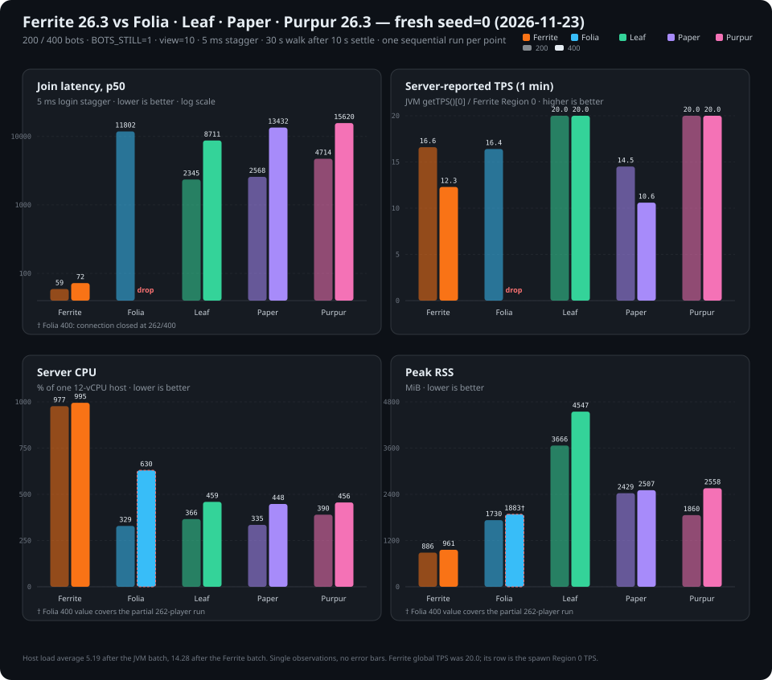

<div align="center">

# Ferrite

**Folia 스타일 리전 멀티스레딩 기반 순수 Rust Minecraft Java 26.3 서버**  
<sub>단일 틱 루프 병목을 없애고 바닐라 26.3 코어를 네이티브 Rust 병렬 아키텍처로 구현했습니다.</sub>

<p>
  
  
  
  
  
</p>

<p>
  <a href="#-벤치마크-ferrite-vs-folia--paper--purpur--leaf">벤치마크</a> ·
  <a href="#-핵심-기능">핵심 기능</a> ·
  <a href="#-빠른-시작">빠른 시작</a> ·
  <a href="#-구현-상태">구현 상태</a> ·
  <a href="#-크레이트-구조">크레이트</a> ·
  <a href="docs/CONFIG.md">설정 가이드</a> ·
  <a href="README.en.md">English</a>
</p>

</div>

---

## ⚡ 벤치마크: Ferrite vs Folia · Paper · Purpur · Leaf

> **2026-11-23 새 측정**: 12-vCPU Xeon Platinum 8358, 62 GiB RAM, Linux, Java 25 `-Xms1G -Xmx4G`에서 서버를 **한 번에 하나씩 단독 순차 실행**했습니다. 모두 **빈 `seed=0` 월드**, `view-distance=10`, `simulation-distance=10`, 5 ms 간격 **200/400봇**, 10초 정착 후 30초 이동(`BOTS_STILL=1`) 조건입니다. Ferrite는 `254c444d` 릴리즈 바이너리, JVM은 26.3 최신 빌드(Paper 259, Folia 26, Purpur 2660, Leaf 28)입니다.

<p align="center">
  
</p>

| 측정 항목 | Ferrite | Folia 26.3 | Leaf 26.3 | Paper 26.3 | Purpur 26.3 |
|---|---:|---:|---:|---:|---:|
| **200봇 접속 `p50` / `p99`** | **59 / 112 ms** | 11,802 / 24,850 ms | 2,345 / 8,673 ms | 2,568 / 13,037 ms | 4,714 / 10,866 ms |
| **200봇 서버 TPS** | 16.6 *(스폰 리전)* | 16.4 | **20.0** | 14.5 | **20.0** |
| **200봇 JVM 10초 틱 `평균 / p99`** | —* | 30.05 / 70.19 ms | 16.16 / 22.76 ms | 17.56 / 25.59 ms | 29.37 / 66.91 ms |
| **200봇 CPU / 피크 RSS** | 977% / **886 MiB** | 329% / 1,730 MiB | 366% / 3,666 MiB | 335% / 2,429 MiB | 390% / 1,860 MiB |
| **400봇 접속 `p50` / `p99`** | **72 / 198 ms** | *262/400에서 연결 종료†* | 8,711 / 19,919 ms | 13,432 / 27,589 ms | 15,620 / 26,902 ms |
| **400봇 서버 TPS** | 12.3 *(스폰 리전)* | —† | **20.0** | 10.6 | **20.0** |
| **400봇 JVM 10초 틱 `평균 / p99`** | —* | —† | 41.62 / 55.36 ms | 45.19 / 62.50 ms | 44.40 / 59.75 ms |
| **400봇 CPU / 피크 RSS** | 995% / **961 MiB** | 630% / 1,883 MiB† | 459% / 4,547 MiB | 448% / 2,507 MiB | 456% / 2,558 MiB |

<sub>* Ferrite의 `/mspt`는 코디네이터/전역 틱(`0.02–0.04 ms`)이라 JVM의 리전 틱과 같은 행에 놓지 않았습니다. Ferrite의 비교 가능한 값은 스폰 `Region 0`의 TPS이며, 전역 TPS는 200/400봇 모두 `20.0`이었습니다. † Folia 400봇은 262명 시점에 `server closed the connection`으로 종료됐고, CPU/RSS는 그 부분 실행 값입니다. TPS는 서버 자체 1분 값으로 조인 폭주를 포함합니다.</sub>

- **400봇 전원 완주 + 압도적인 조인 지연**: Ferrite는 400/400 접속을 완료했고 `p50 72 ms`(`p99 198 ms`)를 기록했습니다. 같은 400봇에서 Leaf `8.7 s`, Paper `13.4 s`, Purpur `15.6 s`였으므로 Ferrite가 각각 약 **121x / 187x / 217x** 빠릅니다. 200봇에서도 `59 ms`로 Leaf `2.3 s`, Paper `2.6 s`, Purpur `4.7 s`, Folia `11.8 s`보다 훨씬 짧습니다.
- **RSS 961 MiB — JVM의 1/3~1/5**: 400봇 피크 RSS는 Ferrite `961 MiB`, Paper `2,507 MiB`, Purpur `2,558 MiB`, Leaf `4,547 MiB`였습니다. 200봇에서도 Ferrite `886 MiB`로 가장 낮았습니다.
- **CPU는 더 씁니다**: Ferrite는 200봇 `977%`, 400봇 `995%`로 12-vCPU를 거의 포화시켰습니다. 완주한 JVM 서버는 `448–459%`(400봇)였습니다. 이는 월드젠·라이팅·세션을 병렬화해 조인 지연을 줄인 **처리량-지연 트레이드오프**이지 CPU 절감이 아닙니다.
- **틱 우위는 주장하지 않습니다**: 400봇에서 Ferrite의 스폰 리전은 `12.3 TPS`였고, Leaf·Purpur는 `20.0 TPS`를 유지했습니다. Ferrite의 강점은 조인 지연과 메모리이며, 이 워크로드에서 틱 시간까지 앞선다고 말하지 않습니다.
- **단일 관측 · 호스트 부하 변동**: JVM 배치 후 1분 부하 `5.19`, Ferrite 배치 후 `14.28`였고 서버별 1회 측정이라 오차 막대가 없습니다. Folia는 400봇에서 262명까지 접속한 뒤 연결이 끊겼습니다.

<sub>조건·원시 수치·지표 해석은 [2026-11-23 상세 벤치마크 리포트](docs/perf/2026-11-23/server-comparison.md)에 있습니다. 과거 50–400봇·fixture·A/B 기록은 [2026-11-21 리포트](docs/perf/2026-11-21/server-comparison.md)와 [성능 베이스라인](docs/perf/README.md)에 보존되어 있습니다.</sub>


---

## ✨ 핵심 기능

### 🔀 Folia 스타일 리전 멀티스레딩 (`ferrite-region`)
월드 내 서로 떨어진 활성 구역을 독립적인 리전으로 분할해 병렬 틱 처리하며, 리전 병합·분할 및 크로스 리전 엔티티/레드스톤/포탈 이동을 소유권 이전 프로토콜로 안전하게 조율합니다. 4,096청크 홀더 배치 변경 시 코디네이터 시그널 시간을 `13.00 ms → 2.64 ms`로 단축했습니다.

### 🌍 순수 Rust 병렬 월드젠 (`ferrite-worldgen`)
별도 JVM 프로세스 없이 Overworld, Nether, End 지형과 바이옴, 동굴, 구조물(Jigsaw·장식)을 멀티코어로 직접 생성합니다(레거시 `ferrite-jvm` 호스트 제거 완료).

### 💡 ScalableLux 스타일 병렬 라이팅 풀 (`ferrite-light`)
`--lighting-pool` 활성화 시 `(chunk_x, chunk_z)` 전역 락 순서와 워커별 로컬 엔진을 사용해 락 경합 없이 청크 조명을 병렬 재계산합니다. 12개 전체 높이(`-4..=19`) 작업 기준 **8워커 5.23x 가속**을 달성했고, `201,326,592`개 블록/종류 대조에서 오차 0건을 검증했습니다. [라이팅 벤치 →](docs/perf/2026-11-21/lighting-bench.md)

### 💾 `.fworld` (`FWRD` v3) RAM-Blob & Anvil 스토리지 / 고속 네트워크 (`ferrite-world`, `ferrite-net`)
- **영구 저장 백엔드 (비저장 인메모리 모드 제거)**:
  - `--storage fworld` (기본값, `.fworld` / `FWRD` v3): 청크별 독립 압축 레코드(`FworldColdStore`) + 스트리밍 디코딩으로 RAM 상주 메모리를 절약하면서 미변경 청크 재압축 없이 일괄 병렬 NBT 직렬화·압축 후 즉시 원자적 저장하며, 멀티코어 병렬 압축/해제·`xxh32` 무결성 체크섬·사전 크기 상한 검증을 수행합니다(64청크 LZ4 저장 **`3.85 ms`** — 직렬 Anvil `41.18 ms` 대비 **10.71x**, 증분 4/64청크 저장 **`0.84 ms`**, 콜드 로드 **`0.08 ms`**).
  - `--storage anvil`: 최대 8-리전 병렬 플러시(`2.62x`–`7.67x` LZ4), `Arc<Chunk>` Copy-on-Write 청크 스냅샷, `RwLock` + `O(1)` 좌표 인덱싱 캐시를 지원하는 표준 Anvil(`mca`) 호환 저장소. [설정 가이드 →](docs/CONFIG.md)
- **네트워크 파이프라인**: `libdeflate` 레벨 1–12 압축·비압축성 패킷 자동 생략, **1회 압축 팬아웃(`Outbound::SharedFrame`)**·**스레드 로컬 패킷 스크래치 직렬화** 및 **`GlobalRegion` 경량 `TickPlayer`/`AddEntity` 캐시**로 다수 플레이어 브로드캐스트 및 **청크 패킷(`level_chunk_with_light`) 스트리밍 중복 압축 제거**, `4 KiB` 이상 배치 블로킹 풀 오프로드(128연결 p99 `184.7 ms → 35.5 ms`), IP별 연결 토큰 버킷·채팅/명령어 속도 제한·최대 연결 수 제한·30초 keepalive/configuration 타임아웃·세션 인증 HTTP 타임아웃(5초/10초) 내장. [오프로드 설계 →](docs/NET-WRITER-OFFLOAD.md)

### 🎮 바닐라 26.3 게임플레이 & 최적화 (`ferrite-entity`, `ferrite-command`, `ferrite-net`)
62종 바닐라 몹(Piglin Hoglin 사냥·댄스, Witch 레이더 치유, Goat 뿔 부러짐 드롭, Fox 은신 예외/열매 채집, Killer Bunny/당근 서리, Mooshroom 번개 변이, Hard 거미 스폰 포션 등)·디스펜서/피스톤 골렘 조립·생존/전투·번식·주민 거래·떠돌이 상인·레드스톤/호퍼/피스톤·양조/비컨·네더/엔드 드래곤 전투와 바닐라 94개 명령어 루트(`strict` 블록 배치, 내장 `vanilla` 데이터팩, `/test create|pos|run*`, 런타임 월드 기본 컨텍스트 포함 `91/94` 트리 일치)를 구현했습니다. 16샤드 `settings` 및 코디네이터 활동 배치, `FxMap`/`FxSet`·2x2 `ChunkReadCache`, 무락 `SharedFrame`/큐 버퍼 재사용, TLS 월드젠/선형 스플라인·팔레트 재사용 및 `raycast_shapes`/`no_collision` 최적화를 적용했으며, 공식 26.3 코덱 검증(`tools/wirecheck`)에서 라이브 캡처 **`ok=543 bad=0`** 및 62종 전 몹 메타데이터 **`ok=144 bad=0`** 통과를 확인했습니다. [명령어 현황 →](docs/COMMANDS-STATUS.md)

---

## 🚀 빠른 시작

필요: **Rust stable** (`rust-toolchain.toml`은 Linux GNU 고정, Windows/macOS는 `RUSTUP_TOOLCHAIN=stable`), **Python 3**, 최초 1회 바닐라 데이터 추출용 **Java 25**. (Windows GUI 실행 시 Edge WebView2 Runtime 필요)

```sh
source tools/env.sh                        # Windows Git Bash (PowerShell: . .\tools\env.ps1)
python tools/fetch_vanilla.py              # 공식 26.3 데이터 로컬 추출 (최초 1회)
cargo run --release -p ferrite-server -- --headless --storage fworld --lighting-pool
```

처음 실행하면 `eula.txt`를 생성하고 종료합니다. [Minecraft EULA](https://aka.ms/MinecraftEULA)를 읽고 동의하는 경우 직접 `eula=true`로 수정한 뒤 다시 실행하세요.  
Windows에서는 인자 없이 `ferrite-server.exe`를 실행하면 **Tauri 2 GUI** 콘솔이 열리며, `--headless` 또는 Linux 환경에서는 표준 입출력 콘솔로 동작합니다. [콘솔/GUI 안내 →](docs/windows-console.md)

### 테스트 및 검증

```sh
cargo test --workspace
cargo clippy --workspace --all-targets -- -D warnings
cargo fmt --all --check
```

---

## 📊 구현 상태

| 구분 | 내용 |
|---|---|
| ✅ **동작 (봇·자동 테스트 검증)** | 로그인·암호화·서명 채팅·Proxy 포워딩(Velocity/Bungee), 리전 멀티스레딩, `.fworld`/Anvil IO·병렬 라이팅·순수 Rust 월드젠, 인벤토리·제작·컨테이너·주민 거래·떠돌이 상인, 62종 몹/AI·번식·생존, 레드스톤·호퍼·피스톤·디스펜서/명령 블록·양조·비컨, 네더·엔드 포탈·드래곤 전투/게이트웨이, 26.3 플레이 패킷(게임모드 전환·픽 블록/엔티티·책 편집·직소·클라이언트 정보 등) 및 94개 명령 루트([명령어 현황](docs/COMMANDS-STATUS.md)) |
| 🟡 **부분 구현** | 피스톤 애니메이션·드래곤 돌진/화염구 근사([`docs/pistons.md`](docs/pistons.md), [`docs/end-dimension.md`](docs/end-dimension.md)), 일부 몹 세부 골 패리티([`docs/mob-ai-parity.md`](docs/mob-ai-parity.md)) |
| ⛔ **미완료** | **실제 Minecraft 26.3 클라이언트 화면/UI 수동 검증** ([`docs/manual-checklist.md`](docs/manual-checklist.md)) — 모든 자동 검증은 프로토콜 봇·코덱 대조 기준입니다. |

남은 작업과 로드맵은 [`docs/BACKLOG.md`](docs/BACKLOG.md)에서 단일 관리합니다. *(바닐라 전용 범위이며 Bukkit/Paper/Spigot 플러그인 API 호환성은 지원하지 않습니다.)*

---

## 📦 크레이트 구조

| 크레이트 | 역할 |
|---|---|
| `ferrite-protocol`, `ferrite-net` | 패킷 코덱(26.3/777), TCP 프레이밍, 암호화, 압축·배치 오프로드, 속도 제한 |
| `ferrite-region` | Folia 스타일 리전라이저 및 리전 스케줄러 |
| `ferrite-world`, `ferrite-light`, `ferrite-worldgen`, `ferrite-nbt` | 청크·`.fworld`/Anvil IO, ScalableLux 병렬 라이팅 풀, 순수 Rust 월드젠, NBT |
| `ferrite-entity`, `ferrite-fluid`, `ferrite-inventory`, `ferrite-item`, `ferrite-recipe`, `ferrite-loot` | 엔티티·몹 AI, 유체, 메뉴·아이템·레시피·전리품 |
| `ferrite-command`, `ferrite-admin`, `ferrite-profiler` | 명령 디스패처, 게임룰·권한, `/tps`·`/mspt`·`/profile` |
| `ferrite-data`, `ferrite-text`, `ferrite-math`, `ferrite-config`, `ferrite-console` | 바닐라 데이터 테이블, 텍스트 컴포넌트, 수학, 설정, 콘솔 |
| `ferrite-server` | 서버 바이너리: CLI/Tauri GUI, 설정, 월드 루프 배선 |

---

## ⚖️ 법적 고지 및 라이선스

- 이 저장소는 **Mojang의 코드나 에셋을 배포하지 않습니다.** 바닐라 데이터는 사용자 환경에서 공식 서버 jar로부터 로컬 추출(`vanilla/`, gitignore)됩니다. Minecraft는 Mojang Studios의 상표이며, 이 프로젝트는 Mojang·Microsoft와 무관한 비공식 프로젝트입니다.
- **라이선스**: **GPL-3.0-or-later** ([`LICENSE`](LICENSE)). Paper·Folia·Lithium 등 GPL/LGPL 기반 최적화 설계 및 코드를 참고/포팅하기 위해 GPLv3를 채택했으며, 출처는 [`NOTICE.md`](NOTICE.md)에 명시되어 있습니다.
