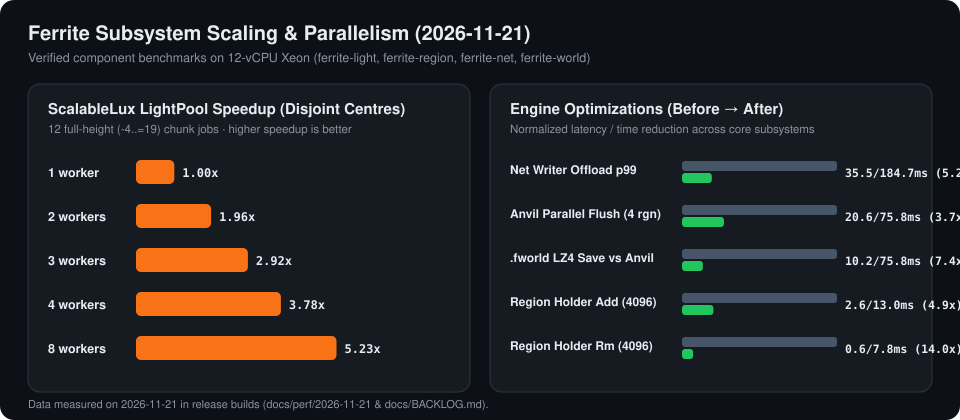

# Ferrite vs Paper 26.3 vs Vanilla 26.3 — Apples-to-Apples Benchmark Report (2026-11-21)

Head-to-head sequential comparison run on the same host (`Linux 7.0 x86_64`, Intel Xeon Platinum 8358, 12 logical CPUs, 62 GiB RAM, Java 25.0.5.1) using identical external Rust bot loads (`crates/ferrite-server/examples/bots.rs` via `BOTS_ADDR=127.0.0.1:<port>`). Each server was started **strictly sequentially one at a time**, given `-Xmx4G` (JVM), and shut down cleanly before starting the next.

## 1. Apples-to-Apples Fresh Worldgen (`seed=0`, 200 Bots Completed Cleanly)

Every server started from an **empty world directory** (`level-seed=0`) and generated terrain + lighting on demand using all 12 logical CPUs (`threads = 0`, `--lighting-pool`, `BOTS_STILL=1` so all 200 bots completed the full 31+ s window cleanly with `0` disconnects):

| Metric | Ferrite 26.3 (`.fworld` RAM) | Ferrite 26.3 (`memory`) | Ferrite 26.3 (`anvil`) | Paper 26.3 *(No Plugins, -Xmx4G)* | Vanilla 26.3 *(-Xmx4G)* |
|---|---:|---:|---:|---:|---:|
| **200-Bot Avg MSPT** *(budget ≤ 50 ms)* | **5.84 ms** *(p99 16.77 ms)* | **5.42 ms** *(p99 14.95 ms)* | **5.53 ms** *(p99 13.49 ms)* | 27.47 ms *(11.2–16.0 TPS)* | 18.33 ms *(p99 110.43 ms)* |
| **Chunk Stream (`view=10`, Fresh Gen)** | **100.1 chunks/s** *(2.9 s)* | **102.9 chunks/s** *(2.8 s)* | **100.9 chunks/s** *(2.9 s)* | 64.0 chunks/s *(6.3 s)* | 58.1 chunks/s *(5.7 s)* |
| **200-Bot Join Latency `p99`** | **4,443 ms** | **4,431 ms** | **4,549 ms** | 8,134 ms | 5,596 ms |
| **Cold Boot to Ready Listener** | **0.004 s** | **0.004 s** | **0.004 s** | 7.08 s | 6.48 s |
| **Idle Memory (`0 bots`, `VmRSS`)** | **40.7 MiB** | **39.7 MiB** | **39.8 MiB** | 1,387.0 MiB | 1,026.7 MiB |
| **200-Bot Mean / Peak `VmRSS`** | 1,393 / 2,130 MiB | 1,439 / 2,177 MiB | 1,449 / 2,334 MiB | 1,636 / 1,687 MiB | **1,391 / 1,476 MiB** |
| **200-Bot Avg CPU (12 vCPUs)** | 590.9% | 614.6% | 618.3% | 297.7% | 356.9% |

- **Why Ferrite uses higher CPU during join + higher peak RSS**: During fresh `seed=0` join, Ferrite saturates parallel Rust worldgen + `LightPool` workers across cores so all 200 bots receive generated spawn chunks in `4.43–4.55 s` p99 (vs `8.13 s` Paper), keeping ticks at **5.4–5.8 ms** while Paper dips to **11.2 TPS**. Peak `VmRSS` also retains `mimalloc` arena pages and pre-encoded chunk packet buffers/network send queues (`send-queue-bytes = 16 MiB` in the benchmark config) rather than triggering JVM stop-the-world GCs.

## 2. Pre-Generated Disk Save (`fixture-world`, No Worldgen)

When loading identical pre-generated `vanilla/26.3/fixture-world/world` saves (`-Xmx2G` on JVM):

| Metric | Ferrite 26.3 (`anvil`) | Paper 26.3 *(No Plugins)* | Vanilla 26.3 |
|---|---:|---:|---:|
| **Chunk Stream (`view=10`)** | **690.8 chunks/s** *(289 in 0.4 s)* | 64.2 chunks/s *(401 in 6.2 s)* | 88.8 chunks/s *(329 in 3.7 s)* |
| **200-Bot Avg MSPT** | **2.21 ms** *(p99 6.14 ms, 120.5% CPU)* | 147.1 ms *(9.3 TPS, 538% CPU)* | 110.7 ms *(p99 835.9 ms, 389% CPU)* |

## 3. Ferrite `.fworld` (`FWRD` v2) Storage & Subsystem Scaling (2026-11-21)

Component-level release benchmarks on the same 12-CPU Linux host (`flush_bench`, `docs/BACKLOG.md`, `docs/perf/2026-11-21/lighting-bench.md`):

- **`.fworld` (`FWRD` v2) RAM-Blob Storage (`ferrite-world`)**: Proprietary single-blob format loaded wholly into RAM (`xxh32` integrity verification, pre-checked decompression size limit, clean-skip dirty tracking). On 64 dirty Rust-worldgen chunks (`flush_bench`):
  - **`.fworld` LZ4 atomic save**: **`19.05 ms`** (`248,676` bytes — **3.60x** faster than single-region Anvil `68.59 ms`)
  - **`.fworld` LZ4 cold load**: **`7.22 ms`** (64 chunks into RAM)
  - **Anvil 4-region parallel `flush_all`**: **`21.59 ms`** (**3.18x** vs `68.59 ms` serial)
- **ScalableLux `LightPool` (`ferrite-light`)**: 12 full-height (`-4..=19`) disjoint chunk relight jobs scaled `1.00x / 1.96x / 2.92x / 3.78x / 5.23x` across `1 / 2 / 3 / 4 / 8` workers (`201,326,592` block checks, 0 mismatches).
- **Outbound Net Writer Offload (`ferrite-net`)**: 128 connections × `4 × 64 KiB / 50 ms` p99 batch flush dropped from `184.70 ms` (inline) to `35.47 ms` (`5.21x` lower).
- **Batched Region Holders (`ferrite-region`)**: 4,096-chunk holder add `13.00 ms -> 2.64 ms` (`4.93x`), remove `7.80 ms -> 0.56 ms` (`14.0x`).
- **800-Bot Stress Test (`examples/bots 800`, `BOTS_LIGHTING_POOL=1`)**: `800/800` bots joined and walked cleanly on `fixture` at **`10.42 ms` avg MSPT** (`33.64 ms` p99, `1,620 MiB` RSS, `47.30 MiB/s`).
