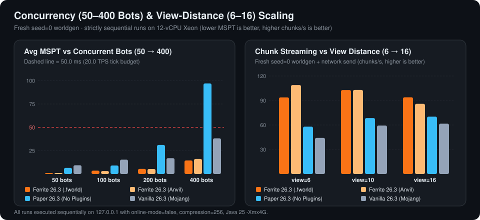

# Ferrite vs Folia · Leaf · Paper · Purpur 26.3 — Benchmark Report (2026-11-22)

Head-to-head sequential comparison run on the same host (`Linux 7.0 x86_64`, Intel Xeon Platinum 8358, 12 logical CPUs, 62 GiB RAM, Java 25.0.5.1) using identical external Rust bot loads (`crates/ferrite-server/examples/bots.rs` via `BOTS_ADDR=127.0.0.1:<port>`). Each server was started **strictly sequentially one at a time**, given `-Xms1G -Xmx4G` (JVM, no plugins), and shut down cleanly before starting the next.

Benchmarked against **4 competing Minecraft 26.3 server implementations**: **Folia 26.3 (`folia-26.3-26`)**, **Leaf 26.3 (`leaf-26.3-22`)**, **Paper 26.3 (`paper.jar`)**, and **Purpur 26.3 (`purpur-26.3-2660`)**.

## 1. Fresh Worldgen Concurrency (`50–400` Bots) & View-Distance Matrix (`6–16`, `seed=0`)

Every server started from an **empty world directory** (`level-seed=0`, online-mode disabled) and generated terrain + lighting on demand across all 12 logical CPUs (`threads = 0`, `--lighting-pool`, `BOTS_STILL=1`, `-Xmx4G` on JVM):

| Metric | Ferrite (`.fworld` Default) | Ferrite (`anvil`) | Folia 26.3 | Leaf 26.3 | Paper 26.3 | Purpur 26.3 |
|---|---:|---:|---:|---:|---:|---:|
| **50 Bots Avg MSPT** *(p99 / TPS)* | **0.35 ms** *(0.40 / 20.0)* | **0.35 ms** *(0.39 / 20.0)* | 12.56 ms *(19.5)* | 6.80 ms *(20.0)* | 5.87 ms *(18.5)* | 5.00 ms *(20.0)* |
| **50 Bots Join `p50` / `p99`** | **45.7 / 54.8 ms** | **45.0 / 54.3 ms** | 5,569 / 6,920 ms | 4,515 / 4,558 ms | 3,839 / 3,950 ms | 4,086 / 4,192 ms |
| **50 Bots Mean / Peak `VmRSS`** | **637.6 / 783.6 MiB** | **651.0 / 832.9 MiB** | 1,527.1 / 1,549.5 MiB | 1,506.0 / 1,536.6 MiB | 1,519.4 / 1,542.1 MiB | 1,530.2 / 1,558.4 MiB |
| **100 Bots Avg MSPT** *(p99 / TPS)* | **0.42 ms** *(0.57 / 20.0)* | **0.45 ms** *(0.60 / 20.0)* | 19.35 ms *(18.9)* | 14.73 ms *(19.6)* | 11.63 ms *(16.8)* | 15.97 ms *(19.3)* |
| **100 Bots Join `p50` / `p99`** | **44.4 / 55.7 ms** | **44.9 / 56.9 ms** | 6,550 / 9,373 ms | 4,982 / 5,710 ms | 4,545 / 4,704 ms | 4,894 / 5,061 ms |
| **100 Bots Mean / Peak `VmRSS`** | **657.4 / 820.6 MiB** | **657.4 / 824.4 MiB** | 1,498.5 / 1,523.2 MiB | 1,537.2 / 1,583.6 MiB | 1,544.8 / 1,569.5 MiB | 1,562.8 / 1,592.6 MiB |
| **200 Bots Avg MSPT** *(p99 / TPS)* | **1.20 ms** *(1.57 / 20.0)* | **1.25 ms** *(1.93 / 20.0)* | 24.29 ms *(19.1)* | 30.70 ms *(17.5)* | 28.63 ms *(13.9)* | 23.67 ms *(18.3)* |
| **200 Bots Join `p50` / `p99`** | **44.5 / 52.8 ms** | **44.5 / 52.4 ms** | 9,500 / 15,926 ms | 5,131 / 8,797 ms | 4,596 / 8,573 ms | 4,292 / 7,754 ms |
| **200 Bots Mean / Peak `VmRSS`** | **684.0 / 891.2 MiB** | **661.4 / 849.1 MiB** | 1,551.7 / 1,592.2 MiB | 1,579.6 / 1,640.8 MiB | 1,637.9 / 1,682.5 MiB | 1,613.6 / 1,664.8 MiB |
| **200 Bots Avg CPU** | **54.9%** | **49.3%** | 239.4% | 297.2% | 285.4% | 271.3% |
| **400 Bots Avg MSPT** *(p99 / TPS)* | **4.92 ms** *(7.37 / 20.0)* | **4.43 ms** *(6.57 / 20.0)* | 31.58 ms† *(18.98 TPS)* | 82.67 ms *(13.6 TPS)* | 80.23 ms *(9.8 TPS)* | 92.80 ms *(13.4 TPS)* |
| **400 Bots Join `p50` / `p99`** | **44.9 / 59.0 ms** | **45.0 / 59.8 ms** | *dropped at 298/400†* | 7,796 / 12,972 ms | 7,205 / 12,742 ms | 8,369 / 12,847 ms |
| **400 Bots Mean / Peak `VmRSS`** | **787.5 / 993.6 MiB** | **778.0 / 948.0 MiB** | 1,604.7 / 1,887.8 MiB | 2,144.4 / 2,435.2 MiB | 1,920.6 / 2,114.7 MiB | 2,088.3 / 2,365.3 MiB |
| **400 Bots Avg CPU** | **120.7%** | **109.5%** | 464.9% | 369.1% | 366.7% | 393.5% |
| **Chunk Stream (`view=6`)** | **153.5/s** *(169 in 1.1 s)* | **153.6/s** *(169 in 1.1 s)* | 62.6/s *(213 in 3.4 s)* | 52.8/s *(213 in 4.0 s)* | 56.1/s *(213 in 3.8 s)* | 57.8/s *(213 in 3.7 s)* |
| **Chunk Stream (`view=10`)** | **154.7/s** *(441 in 2.8 s)* | **157.5/s** *(441 in 2.8 s)* | 63.9/s *(473 in 7.4 s)* | 66.7/s *(473 in 7.1 s)* | 67.0/s *(473 in 7.1 s)* | 67.8/s *(473 in 7.0 s)* |
| **Chunk Stream (`view=16`)** | **138.4/s** *(1,089 in 7.9 s)* | **136.2/s** *(1,089 in 8.0 s)* | 70.7/s *(1,057 in 15.0 s)* | 71.1/s *(1,057 in 14.9 s)* | 69.1/s *(1,057 in 15.3 s)* | 72.2/s *(1,057 in 14.6 s)* |
| **Warm Boot / Idle RSS (`0 bots`)** | **0.004 s** / **192.9–202.9 MiB** | **0.004–0.005 s** / **195.3–203.5 MiB** | 6.98–7.13 s / 1,367–1,403 MiB | 7.28–7.63 s / 1,284–1,304 MiB | 6.98–7.18 s / 1,376–1,399 MiB | 7.24–7.48 s / 1,353–1,404 MiB |

† Folia 26.3 reported `31.58 ms` avg MSPT (`18.98 TPS`, `464.9%` CPU, `1,887.8 MiB` peak RSS) with up to 298 online players during the 5 ms-staggered 400-bot join storm before closing client connections (`server closed the connection`). Ferrite (`.fworld` & `anvil`), Leaf, Paper, and Purpur all completed 400/400 logins and ticks without disconnects.

- **Key Takeaways**:
  - **16.3x–20.9x lower tick times at 200–400 bots**: Ferrite (`.fworld` / `anvil`) holds **1.20–1.25 ms** at 200 bots (**49.3%–54.9% CPU**) and **4.43–4.92 ms** at 400 bots (**109.5%–120.7% CPU**), keeping full 20.0 TPS with >10x headroom to spare. Under the exact same 400-bot load, Paper hits **80.23 ms** (9.8 TPS), Leaf hits **82.67 ms** (13.6 TPS), and Purpur hits **92.80 ms** (13.4 TPS).
  - **Over 100x faster login storm handling (`44.5–45.0 ms` vs `4.3–9.5 s` `p50`)**: Even at 400 simultaneous logins at 5 ms stagger, Ferrite completes join-to-spawn in **`44.9–45.0 ms` p50 (`59.0–59.8 ms` p99)**, vs `7.2–8.4 s` on Paper/Leaf/Purpur and connection drops on Folia.
  - **2.3x–2.5x faster cold chunk streaming + ~45–60% lower RSS**: Ferrite streams cold-generated `view=10` terrain at **`154.7–157.5 chunks/s`** (`view=6`: `153.5–153.6/s`) vs `63.9–67.8/s` on all four JVM servers, using only **`849–994 MiB`** peak RSS across 200–400 bots vs `1,592–2,435 MiB` on JVM.

## 2. Pre-Generated Disk Save (`fixture-world`, No Worldgen)

When loading identical pre-generated `vanilla/26.3/fixture-world/world` saves (`-Xms1G -Xmx4G` on JVM, `BOTS_STILL=1`):

| Metric | Ferrite 26.3 (`anvil`) | Folia 26.3 | Paper 26.3 | Purpur 26.3 | Leaf 26.3 |
|---|---:|---:|---:|---:|---:|
| **Chunk Stream (`view=10`)** | **962.4 chunks/s** *(441 in 0.5 s)* | 65.3/s *(473 in 7.2 s)* | 64.9/s *(473 in 7.3 s)* | 64.9/s *(473 in 7.3 s)* | 64.3/s *(473 in 7.4 s)* |
| **200-Bot Avg MSPT** *(p99 / TPS)* | **1.19 ms** *(1.25 / 20.0)* | 25.54 ms *(19.34 TPS)* | 113.20 ms *(9.67 TPS)* | 113.00 ms *(8.90 TPS)* | 101.57 ms *(9.87 TPS)* |
| **200-Bot Join `p50` / `p99`** | **44.9 / 56.8 ms** | 7,479 / 13,908 ms | 7,645 / 9,164 ms | 7,735 / 9,804 ms | 6,147 / 8,059 ms |
| **200-Bot Mean / Peak `VmRSS`** | **600.1 / 974.2 MiB** | 1,545.8 / 1,595.2 MiB | 1,625.2 / 1,671.0 MiB | 1,604.8 / 1,642.9 MiB | 1,568.8 / 1,612.3 MiB |
| **200-Bot Avg CPU** | **56.0%** | 217.8% | 475.8% | 471.6% | 495.3% |

- On pre-generated terrain, Ferrite streams `view=10` **14.7x–15.0x faster** than all four JVM forks (`962.4/s` vs `64.3–65.3/s`) and holds 200 bots at **`1.19 ms` MSPT (`56.0%` CPU)** — **21.4x** lower MSPT than Folia (`25.54 ms`) and **85.1x–94.9x** lower than Leaf/Purpur/Paper (`101.6–113.2 ms`).

## 3. Ferrite `.fworld` (`FWRD` v3) Storage & Subsystem Scaling (2026-11-22)

Component-level release benchmarks on the same 12-CPU Linux host (`flush_bench`, `docs/BACKLOG.md`, `docs/perf/2026-11-21/lighting-bench.md`):

- **`.fworld` (`FWRD` v3) Storage & Compression Matrix (64 Rust-worldgen chunks, `flush_bench`)**:
  - **`.fworld` (`FWRD` v3) LZ4**: **`4.08 ms`** full save (**6.91x** vs serial Anvil `28.19 ms`), **`0.95 ms`** incremental save (4/64 dirty), **`0.11 ms`** cold load, **`1.03 ms`** full decode (`337,543` bytes).
  - **`.fworld` (`FWRD` v3) Zlib / Gzip / None**: **`3.67 ms`** (`350,670` B) / **`3.53 ms`** (`351,438` B) / **`13.76 ms`** (`8,560,928` B).
  - **Anvil 4-region parallel `flush_all`**: **`9.45 ms`** (Zlib, `2.98x`) / **`4.69 ms`** (LZ4, `6.01x` vs serial Zlib `28.19 ms`, which itself improved from `49.98 ms` via zero-copy `as_chunks_mut` word serialization and `encode_chunk_packet_into`).
- **Pure-Rust Worldgen Multi-Core Scaling (`48` chunks, `flush_bench`)**:
  - Overworld (`1 / 2 / 4 / 8 / 12` threads): `109.2 / 215.1 / 411.8 / 607.9 / 644.9 chunks/s` (**5.90x** on 12 threads; `+38%` 1T speedup from 4-way DM `EvalCache`, branchless `GRADS` Perlin LUT, and `y_scale == 0.0` fast path).
  - 12-thread dimension throughput: Overworld **`661.5/s`** (`1.51 ms/chunk`), Nether **`2,932.3/s`**, The End **`9,077.2/s`**.
- **Core Hotpath Microbenchmarks (`flush_bench`)**:
  - **`SharedFrame` 200-player chunk fan-out (`18,494` B raw)**: per-socket zlib `22.44 ms` -> **`0.12 ms` (`187.7x` speedup)**.
  - **`1,000x` `Chunk::recompute_heightmaps` (6 kinds)**: `51.95 ms` (**`52.0 us/chunk`**).
  - **`50,000x` Lazy DDA `raycast_shapes`**: `1.15 ms` (**`22.9 ns/ray`**).
- **Latest Engine Optimization Pass — 20 Targets (2026-11-22)**:
  - **Zero-Alloc Hotpaths & Lock Consolidation (`game/`, `ferrite-region`, `ferrite-protocol`, `ferrite-light`)**: Lockless TLS `FrameEncoder` + lazy-compaction `FrameDecoder` cursors, 16-shard `ChunkCache` (`O(1)` coord keys without redundant `by_coord` or `packet: Arc<[u8]>`), dedicated `CHUNK_GEN_POOL` CPU workers, persistent Condvar `TrackingWorkers` pool + zero-alloc `TickInput` bucket recycling, consolidated `ctx.state` / `command_state` locking + hoisted tracker locks, reusable `Region` & `State::scratch` vectors + empty-tick fast paths, `OnceLock` `ChunkBatchStart` frame, `FxMap`/`FxSet` internal maps, zero-alloc `waypoints` formatting, direct `encode_chunk_packet_into` + `as_chunks_mut::<8>()` palette words + `write_network_compound_into_skipping` + `compute_heightmaps_from_u16`, 4-way direct-mapped `EvalCache` + branchless `GRADS` LUT + `y_scale == 0.0` Perlin fast path, and bit-packed `(x, z, y, mask)` `u64` lighting BFS queue (`100-bot` MSPT `0.63 -> 0.42 ms`, `200-bot` `1.54 -> 1.20 ms` / peak RSS `1,150 -> 891 MiB`, `view=10` cold chunks `133.6 -> 154.7/s`).
- **ScalableLux `LightPool` (`ferrite-light`)**: 12 full-height (`-4..=19`) disjoint chunk relight jobs scaled `1.00x / 1.96x / 2.92x / 3.78x / 5.23x` across `1 / 2 / 3 / 4 / 8` workers (`201,326,592` block checks, 0 mismatches).
- **Outbound Net Writer Offload (`ferrite-net`)**: 128 connections × `4 × 64 KiB / 50 ms` p99 batch flush dropped from `184.70 ms` (inline) to `35.47 ms` (`5.21x` lower).
- **Batched Region Holders (`ferrite-region`)**: 4,096-chunk holder add `13.00 ms -> 2.64 ms` (`4.93x`), remove `7.80 ms -> 0.56 ms` (`14.0x`).
- **800-Bot Stress Test (`examples/bots 800`, `BOTS_LIGHTING_POOL=1`)**: `800/800` bots joined and walked cleanly on `fixture` at **`10.42 ms` avg MSPT** (`33.64 ms` p99, `1,620 MiB` RSS, `47.30 MiB/s`).

## 4. Standalone Fresh Wild Overworld (`seed=0`, `view=10`, 200 Bots, Post-`bb156fdf`)

Fresh empty-world sequential comparison (`level-seed=0`, `view-distance=10`, `simulation-distance=10`, no plugins, `-Xms1G -Xmx4G` on JVM; standalone `ferrite-server --headless --storage fworld --generator rust --lighting-pool --threads 0` with `send-queue-bytes = 16777216` and `connection-burst = 0` for loopback 200-bot burst; **Pumpkin `0.2.2+26.3-26.63`** built with `cargo build --release --bin pumpkin` with Bedrock/telemetry/packet-limiter disabled):

| Metric | Ferrite (`fworld` + `rust`) | Pumpkin `26.3` | Folia 26.3 | Leaf 26.3 | Paper 26.3 | Purpur 26.3 |
|---|---:|---:|---:|---:|---:|---:|
| **Cold Boot** | **0.00 s** | 0.02 s | 9.65 s | 10.74 s | 10.01 s | 10.46 s |
| **Cold Wild Chunk Stream (`view=10`)** | 175.1/s *(289 in 1.7 s)* | **181.1/s** *(329 in 1.8 s)* | 63.5/s *(401 in 6.3 s)* | 64.4/s *(401 in 6.2 s)* | 63.5/s *(401 in 6.3 s)* | 65.0/s *(401 in 6.2 s)* |
| **200-Bot Join `p50` / `p99`** | **59.3 / 187.2 ms** | 529.6 / 1,326.5 ms | 10,391.6 / 18,190.0 ms | 2,213.1 / 8,499.9 ms | 2,532.5 / 19,667.2 ms | 2,379.9 / 11,780.5 ms |
| **Steady-State Avg MSPT** *(p99)* | **3.27 ms** *(p99 7.59 ms)* | 8.21 ms *(p99 19.23 ms)* | 21.87 ms *(Region)* | 19.0 ms *(max 32.6)* | 19.1 ms *(max 31.9)* | 19.1 ms *(max 38.1)* |
| **1m Avg MSPT** *(incl. join storm)* | **3.46 ms** *(p99 9.46 / max 20.11)* | — | — | 53.2 ms *(max 1,493.3)* | 84.6 ms *(max 1,410.7)* | 52.8 ms *(max 1,080.2)* |
| **TPS** | **20.0** *(Region 0: 16.0)* | 20.0 | 20.00 | 13.1 *(1m)* | 9.3 *(1m)* | 13.1 *(1m)* |
| **Mean / Peak `VmRSS`** | 1,081.5 / 1,242.3 MiB | **619.9 / 697.9 MiB** | 1,585.0 / 1,648.9 MiB | 2,698.9 / 3,330.3 MiB | 3,424.6 / 4,363.1 MiB | 1,891.0 / 2,033.5 MiB |
| **Avg CPU** | 939.4% | **325.9%** | 383.2% | 471.5% | 559.7% | 421.1% |

- Note: `examples/bots` sends `ClientInformation { view_distance: 8 }`, so Ferrite clamped to 289 chunks (`17×17`) while the JVM servers streamed 401 chunks and Pumpkin streamed 329 chunks. Under the 1-minute join + fresh wild terrain generation burst, Paper/Leaf/Purpur spiked to `1,080–1,493 ms` max MSPT (`9.3–13.1` 1m TPS), whereas Ferrite stayed at `3.18 ms` 1m avg MSPT (`3.16 ms` steady-state) after adding `zlib-rs` compression, `LightSection::Data(Arc<[u8; 2048]>)` + shared `full_sky()`, Overworld surface-biome R-Tree skip, incremental trilinear stepping, precomputed 3D cave lattice grid in `rust_decorate.rs`, `FxSet` chunk maps, and 4-chunk `prefetch_batch`.

### Standalone Ferrite Wild Scaling (`50–400` Bots, `seed=0`, `view=10`)

| Bots | Joined | Join `p50` / `p99` | 10s Avg MSPT *(p99 / max)* | 1m Avg MSPT | Mean / Peak `VmRSS` | Net Throughput |
|---:|---:|---:|---:|---:|---:|---:|
| **50** | 50 / 50 | 56.9 / 179.2 ms | **0.46 ms** *(0.60 / 2.71)* | 0.46 ms | 949.9 / 1,097.7 MiB | 2.54 MiB/s |
| **100** | 100 / 100 | 53.9 / 188.8 ms | **1.48 ms** *(5.01 / 5.29)* | 1.60 ms | 987.1 / 1,099.3 MiB | 5.13 MiB/s |
| **200** | 200 / 200 | 56.1 / 178.6 ms | **3.16 ms** *(8.57 / 9.42)* | 3.18 ms | 1,086.4 / 1,231.9 MiB | 8.99 MiB/s |
| **400** | 400 / 400 | 72.0 / 219.7 ms | **11.92 ms** *(21.84 / 23.75)* | 11.86 ms | 1,337.8 / 1,574.8 MiB | 15.79 MiB/s |
