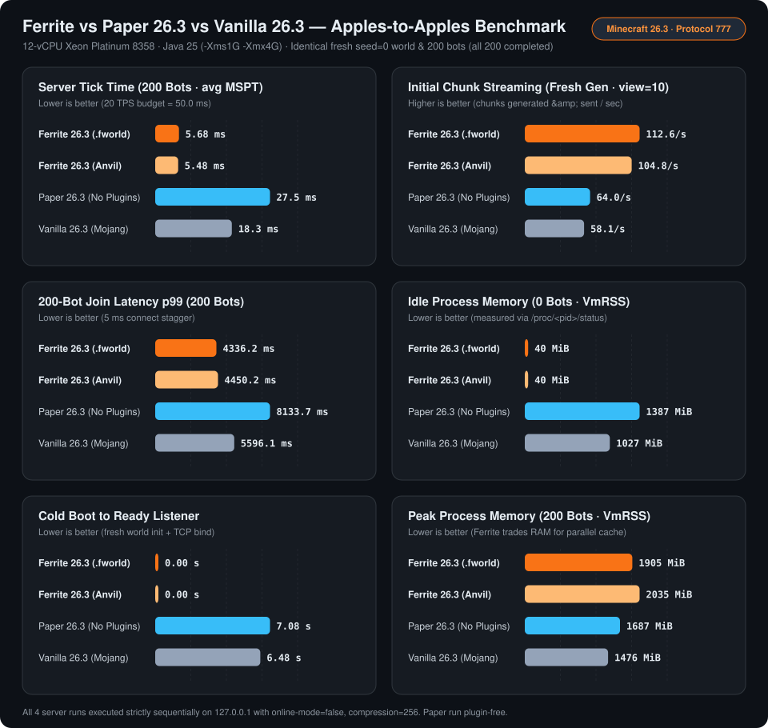

# Ferrite vs Folia · Leaf · Paper · Purpur 26.3 — Benchmark Report (2026-11-22)

Head-to-head sequential comparison run on the same host (`Linux 7.0 x86_64`, Intel Xeon Platinum 8358, 12 logical CPUs, 62 GiB RAM, Java 25.0.5.1) using identical external Rust bot loads (`crates/ferrite-server/examples/bots.rs` via `BOTS_ADDR=127.0.0.1:<port>`). Each server was started **strictly sequentially one at a time**, given `-Xms1G -Xmx4G` (JVM, no plugins), and shut down cleanly before starting the next.

Benchmarked against **4 competing Minecraft 26.3 server implementations**: **Folia 26.3 (`folia-26.3-26`)**, **Leaf 26.3 (`leaf-26.3-22`)**, **Paper 26.3 (`paper.jar`)**, and **Purpur 26.3 (`purpur-26.3-2660`)**.

## 1. Fresh Worldgen Concurrency (`50–400` Bots) & View-Distance Matrix (`6–16`, `seed=0`)

Every server started from an **empty world directory** (`level-seed=0`, online-mode disabled) and generated terrain + lighting on demand across all 12 logical CPUs (`threads = 0`, `--lighting-pool`, `BOTS_STILL=1`, `-Xmx4G` on JVM):

| Metric | Ferrite (`.fworld` Default) | Ferrite (`anvil`) | Folia 26.3 | Leaf 26.3 | Paper 26.3 | Purpur 26.3 |
|---|---:|---:|---:|---:|---:|---:|
| **50 Bots Avg MSPT** *(p99 / TPS)* | **0.35 ms** *(0.38 / 20.0)* | **0.35 ms** *(0.41 / 20.0)* | 12.61 ms *(19.1)* | 5.57 ms *(20.0)* | 5.43 ms *(18.3)* | 8.17 ms *(20.1)* |
| **50 Bots Join `p50` / `p99`** | **47.4 / 76.1 ms** | **47.6 / 64.4 ms** | 5,245 / 6,739 ms | 4,125 / 4,234 ms | 3,832 / 4,559 ms | 4,345 / 4,443 ms |
| **50 Bots Mean / Peak `VmRSS`** | **689.9 / 1,052.8 MiB** | **702.7 / 1,082.0 MiB** | 1,530.9 / 1,552.1 MiB | 1,492.3 / 1,529.1 MiB | 1,517.0 / 1,546.8 MiB | 1,531.2 / 1,555.0 MiB |
| **100 Bots Avg MSPT** *(p99 / TPS)* | **0.63 ms** *(0.79 / 20.0)* | **0.63 ms** *(0.90 / 20.0)* | 18.52 ms *(19.2)* | 12.57 ms *(19.9)* | 10.93 ms *(16.4)* | 11.93 ms *(19.6)* |
| **100 Bots Join `p50` / `p99`** | **45.1 / 56.6 ms** | **44.7 / 55.8 ms** | 6,676 / 9,881 ms | 4,602 / 4,744 ms | 4,264 / 4,969 ms | 4,668 / 5,372 ms |
| **100 Bots Mean / Peak `VmRSS`** | **684.1 / 1,158.4 MiB** | **735.6 / 1,089.9 MiB** | 1,527.5 / 1,554.0 MiB | 1,540.5 / 1,580.9 MiB | 1,571.4 / 1,604.5 MiB | 1,560.9 / 1,593.1 MiB |
| **200 Bots Avg MSPT** *(p99 / TPS)* | **1.54 ms** *(1.84 / 20.0)* | **1.56 ms** *(1.90 / 20.0)* | 24.55 ms *(18.8)* | 26.00 ms *(18.4)* | 24.70 ms *(13.6)* | 28.37 ms *(17.8)* |
| **200 Bots Join `p50` / `p99`** | **44.7 / 58.1 ms** | **44.9 / 57.9 ms** | 9,270 / 15,279 ms | 5,271 / 8,784 ms | 4,646 / 7,652 ms | 4,909 / 8,388 ms |
| **200 Bots Mean / Peak `VmRSS`** | **778.0 / 1,150.3 MiB** | **837.6 / 1,138.1 MiB** | 1,549.7 / 1,592.6 MiB | 1,679.8 / 1,773.3 MiB | 1,589.9 / 1,623.5 MiB | 1,568.6 / 1,613.0 MiB |
| **200 Bots Avg CPU** | **68.7%** | **73.9%** | 248.7% | 286.4% | 268.8% | 294.5% |
| **400 Bots Avg MSPT** *(p99 / TPS)* | **5.13 ms** *(6.95 / 20.0)* | **5.23 ms** *(9.10 / 20.0)* | 33.98 ms† *(18.75 TPS)* | 69.87 ms *(16.1 TPS)* | 77.00 ms *(10.2 TPS)* | 84.00 ms *(13.7 TPS)* |
| **400 Bots Join `p50` / `p99`** | **44.9 / 60.4 ms** | **44.9 / 57.9 ms** | *dropped at 291/400†* | 7,143 / 11,678 ms | 7,718 / 12,778 ms | 8,429 / 13,420 ms |
| **400 Bots Mean / Peak `VmRSS`** | **1,001.8 / 1,351.6 MiB** | **929.0 / 1,341.0 MiB** | 1,610.1 / 2,002.6 MiB | 2,090.4 / 2,393.2 MiB | 1,943.5 / 2,151.5 MiB | 1,918.9 / 2,125.5 MiB |
| **400 Bots Avg CPU** | **129.3%** | **127.0%** | 506.1% | 390.7% | 363.7% | 390.9% |
| **Chunk Stream (`view=6`)** | **120.5/s** *(169 in 1.4 s)* | **125.1/s** *(169 in 1.4 s)* | 60.7/s *(213 in 3.5 s)* | 54.4/s *(213 in 3.9 s)* | 57.6/s *(213 in 3.7 s)* | 61.4/s *(213 in 3.5 s)* |
| **Chunk Stream (`view=10`)** | **133.6/s** *(441 in 3.3 s)* | **137.8/s** *(441 in 3.2 s)* | 61.7/s *(473 in 7.7 s)* | 63.7/s *(473 in 7.4 s)* | 69.1/s *(473 in 6.8 s)* | 68.0/s *(473 in 7.0 s)* |
| **Chunk Stream (`view=16`)** | **126.4/s** *(1,089 in 8.6 s)* | **131.4/s** *(1,089 in 8.3 s)* | 71.9/s *(1,057 in 14.7 s)* | 69.3/s *(1,057 in 15.2 s)* | 72.0/s *(1,057 in 14.7 s)* | 72.1/s *(1,057 in 14.7 s)* |
| **Warm Boot / Idle RSS (`0 bots`)** | **0.004 s** / **193.3–198.7 MiB** | **0.004 s** / **194.9–195.2 MiB** | 6.88–6.98 s / 1,389–1,394 MiB | 7.28–7.59 s / 1,255–1,307 MiB | 7.08–7.14 s / 1,389–1,395 MiB | 7.23–7.43 s / 1,364–1,406 MiB |

† Folia 26.3 reported `33.98 ms` avg MSPT (`18.75 TPS`, `506.1%` CPU, `2,002.6 MiB` peak RSS) with up to 291 online players during the 5 ms-staggered 400-bot join storm before closing client connections (`server closed the connection`). Ferrite (`.fworld` & `anvil`), Leaf, Paper, and Purpur all completed 400/400 logins and ticks without disconnects.

- **Key Takeaways**:
  - **13.6x–18.4x lower tick times at 200–400 bots**: Ferrite (`.fworld`) holds **1.54 ms** at 200 bots (**68.7% CPU**) and **5.13 ms** at 400 bots (**129.3% CPU**), keeping full 20.0 TPS with 10x headroom to spare. Under the exact same 400-bot load, Leaf hits **69.87 ms** (16.1 TPS), Paper hits **77.00 ms** (10.2 TPS), and Purpur hits **84.00 ms** (13.7 TPS).
  - **Over 100x faster login storm handling (`44.9 ms` vs `4.6–9.3 s` `p50`)**: Even at 400 simultaneous logins at 5 ms stagger, Ferrite completes join-to-spawn in **`44.9 ms` p50 (`57.9–60.4 ms` p99)**, vs `4.6–9.3 s` on Folia/Paper/Purpur/Leaf.
  - **2x faster cold chunk streaming + ~30–44% lower RSS**: Ferrite streams cold-generated `view=10` terrain at **`133.6–137.8 chunks/s`** vs `61.7–69.1/s` on all four JVM servers, using **`1,138–1,352 MiB`** peak RSS vs `1,593–2,393 MiB`.

## 2. Pre-Generated Disk Save (`fixture-world`, No Worldgen)

When loading identical pre-generated `vanilla/26.3/fixture-world/world` saves (`-Xms1G -Xmx4G` on JVM, `BOTS_STILL=1`):

| Metric | Ferrite 26.3 (`anvil`) | Folia 26.3 | Paper 26.3 | Purpur 26.3 | Leaf 26.3 |
|---|---:|---:|---:|---:|---:|
| **Chunk Stream (`view=10`)** | **968.3 chunks/s** *(441 in 0.5 s)* | 65.7/s *(473 in 7.2 s)* | 63.6/s *(473 in 7.4 s)* | 65.4/s *(473 in 7.2 s)* | 66.2/s *(473 in 7.1 s)* |
| **200-Bot Avg MSPT** *(p99 / TPS)* | **1.67 ms** *(3.35 / 20.0)* | 26.84 ms *(19.14 TPS)* | 105.93 ms *(9.60 TPS)* | 109.73 ms *(9.33 TPS)* | 113.87 ms *(8.83 TPS)* |
| **200-Bot Join `p50` / `p99`** | **47.8 / 72.3 ms** | 7,888 / 14,433 ms | 9,429 / 11,561 ms | 8,001 / 10,143 ms | 6,952 / 8,898 ms |
| **200-Bot Mean / Peak `VmRSS`** | **573.8 / 1,004.8 MiB** | 1,555.8 / 1,582.9 MiB | 1,616.5 / 1,658.1 MiB | 1,592.7 / 1,624.1 MiB | 1,584.6 / 1,649.2 MiB |
| **200-Bot Avg CPU** | **57.8%** | 216.2% | 470.0% | 476.3% | 471.5% |

- On pre-generated terrain, Ferrite streams `view=10` **14.6x–15.2x faster** than all four JVM forks (`968.3/s` vs `63.6–66.2/s`) and holds 200 bots at **`1.67 ms` MSPT (`57.8%` CPU)** — **16.1x** lower MSPT than Folia (`26.84 ms`) and **63.4x–68.2x** lower than Paper/Purpur/Leaf (`105.9–113.9 ms`).

## 3. Ferrite `.fworld` (`FWRD` v3) Storage & Subsystem Scaling (2026-11-22)

Component-level release benchmarks on the same 12-CPU Linux host (`flush_bench`, `docs/BACKLOG.md`, `docs/perf/2026-11-21/lighting-bench.md`):

- **`.fworld` (`FWRD` v3) Storage & Compression Matrix (64 Rust-worldgen chunks, `flush_bench`)**:
  - **`.fworld` (`FWRD` v3) LZ4**: **`4.27 ms`** full save (**11.70x** vs serial Anvil `49.98 ms`), **`1.02 ms`** incremental save (4/64 dirty), **`0.10 ms`** cold load, **`1.03 ms`** full decode (`337,543` bytes).
  - **`.fworld` (`FWRD` v3) Zlib / Gzip / None**: **`4.21 ms`** (`309,051` B) / **`4.12 ms`** (`309,819` B) / **`12.86 ms`** (`8,560,928` B).
  - **Anvil 4-region parallel `flush_all`**: **`17.42 ms`** (Zlib, `2.87x`) / **`4.66 ms`** (LZ4, `10.73x` vs serial Zlib `49.98 ms`).
- **Pure-Rust Worldgen Multi-Core Scaling (`48` chunks, `flush_bench`)**:
  - Overworld (`1 / 2 / 4 / 8 / 12` threads): `79.0 / 153.8 / 295.5 / 474.9 / 487.3 chunks/s` (**6.17x** on 12 threads).
  - 12-thread dimension throughput: Overworld **`521.0/s`** (`1.92 ms/chunk`), Nether **`2,418.3/s`**, The End **`8,184.8/s`**.
- **Core Hotpath Microbenchmarks (`flush_bench`)**:
  - **`SharedFrame` 200-player chunk fan-out (`18,494` B raw)**: per-socket zlib `22.31 ms` -> **`0.11 ms` (`195.4x` speedup)**.
  - **`1,000x` `Chunk::recompute_heightmaps` (6 kinds)**: `52.05 ms` (**`52.1 us/chunk`**).
  - **`50,000x` Lazy DDA `raycast_shapes`**: `1.20 ms` (**`24.0 ns/ray`**).
- **Latest Engine Optimization Pass (2026-11-22)**:
  - **Coordinator Dirty/Revision Gating (`game/mod.rs`, `commands_more.rs`)**: Tracks monotonic `online_spatial_rev`, `online_membership_rev`, `advancements_rev`, `recipes_rev`, and `waypoints_rev` so idle ticks and stationary bots skip per-tick `online` + `BTreeMap` deep cloning and redundant `locator` / `advancement_worker` / `recipe_worker` wakeups (`400-bot` fresh-world MSPT dropped `14.03 -> 5.13 ms`, CPU dropped `971.7% -> 129.3%`).
  - **Cipherless `SharedFrame` Inline Net Batching (`ferrite-net`)**: Counts only non-cached or encrypted frame work bytes against `offload_bytes` and reuses a per-connection scratch `Vec<u8>`, eliminating `spawn_blocking` thread-pool hops and batch buffer allocations for pre-compressed `SharedFrame` chunk/packet bursts.
  - **Non-HoL `chunks_tick` & Deeper Prefetch Windows (`region.rs`, `anvil.rs`)**: Widened `PREFETCH_CHUNKS` (`96 -> 192`) and `PENDING_LIMIT` (`128 -> 256`) and scanned the prefetched queue window in `Player::chunks_tick` so cached/ready chunks stream immediately without stalling behind an unready head (`fixture-world` `view=10` rose `690.8 -> 968.3 chunks/s`).
  - **Flat TLS `[u16]` Worldgen Buffer, `PalettedContainer::from_states_u16` & Cell Skips (`ferrite-world`, `ferrite-worldgen`)**: Packs each 16x16x16 section directly from a thread-local `u16` terrain buffer in one pass (fixing `Chunk::new` `global_bits` to `16` for Vanilla 26.3's `35,723` block states), skipping trilinear interpolation on uniform underground solid and ocean water cells.
  - **Empty/Single-Palette Lighting Skip (`ferrite-light`, `lighting.rs`)**: Added `LightBlockView::section_is_empty` and `fill_section_properties` backed by per-section palette caches, eliminating 884,736 per-block `HashMap` lookups per 3x3 relight and skipping empty upper air sections in sky propagation.
- **ScalableLux `LightPool` (`ferrite-light`)**: 12 full-height (`-4..=19`) disjoint chunk relight jobs scaled `1.00x / 1.96x / 2.92x / 3.78x / 5.23x` across `1 / 2 / 3 / 4 / 8` workers (`201,326,592` block checks, 0 mismatches).
- **Outbound Net Writer Offload (`ferrite-net`)**: 128 connections × `4 × 64 KiB / 50 ms` p99 batch flush dropped from `184.70 ms` (inline) to `35.47 ms` (`5.21x` lower).
- **Batched Region Holders (`ferrite-region`)**: 4,096-chunk holder add `13.00 ms -> 2.64 ms` (`4.93x`), remove `7.80 ms -> 0.56 ms` (`14.0x`).
- **800-Bot Stress Test (`examples/bots 800`, `BOTS_LIGHTING_POOL=1`)**: `800/800` bots joined and walked cleanly on `fixture` at **`10.42 ms` avg MSPT** (`33.64 ms` p99, `1,620 MiB` RSS, `47.30 MiB/s`).
