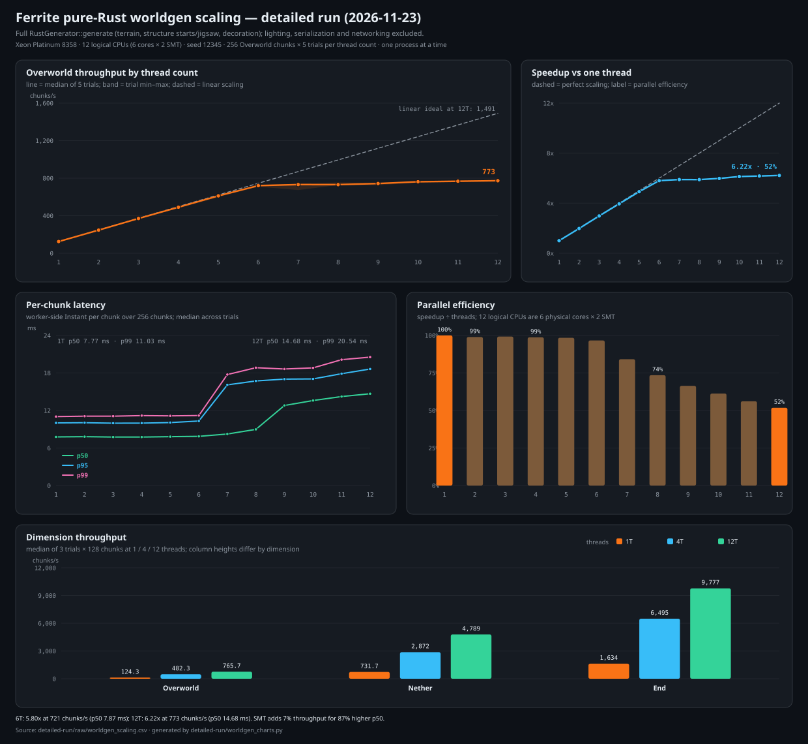

# Ferrite vs Folia · Leaf · Paper · Purpur 26.3 — Chunks, Fixture World, Forceload (2026-11-23)

This pass fills the gaps left by the fresh-world 50/100/200/400-bot comparison: cold chunk
streaming at three view distances, streaming from a pre-generated fixture save, 200 bots
with repeated `/forceload` cycles, Ferrite at 800 bots, Ferrite's storage/worldgen
microbenchmarks, and a detailed 1–12-thread pure-Rust worldgen scaling pass. All five
servers were run one at a time on the same host.

- Ferrite: release binary at `5e76edd2`, `--headless`, Rust worldgen, `.fworld` for fresh
  worlds and Anvil for the fixture save because that save is Anvil.
- JVM: Folia `26.3-26`, Leaf `26.3-28`, Paper `26.3-259`, Purpur `26.3-2660`,
  Java 25.0.5.1, `-Xms1G -Xmx4G`, no gameplay plugins except `BenchProbe.jar`.

## Workload

- Host: 12-vCPU Xeon Platinum 8358, 62 GiB RAM, Linux; shared, with 1-minute load
  `0.45–13.00` across the measured boundaries (`detailed-run/raw/schedule.log`).
- Fresh empty world per run, `seed=0`, view/simulation distance 6, 10 or 16.
- Fixture runs copy `vanilla/26.3/fixture-world/world` (chunks `-3..=18`) with
  `session.lock`, logs and player data excluded. Leaf asks for a world-folder migration
  confirmation; the runner answers `confirm`.
- Chunk stream: one external `examples/bots` client with `BOTS_CHUNKS=1`, connecting and
  counting `ChunkData` until no chunk arrives for 8 s. Two runs per point; the rate is the
  received count divided by the time to the last chunk.
- 200/800 bots: `BOTS_STILL=1`, `BOTS_STAGGER_MS=5`, `BOTS_SETTLE_SECS=10`,
  `BOTS_WALK_SECS=40`, `BOTS_VIEW=10`. One run per point.
- Forceload: 20 cycles of `forceload add -48 -48 207 207` (256 chunks) and
  `forceload remove all` while the 200 bots walk, each followed by a `/seed` console
  marker. The number is command dispatch latency, not the time to finish loading chunks.
- Ferrite TPS is `/tps` 32 s into the 40 s walk; JVM TPS is the last probe row with all
  bots online. JVM tick mean/p99 is the mean of the probe's last ten 1-second samples.

## Fresh-world chunk stream

Mean of two runs, min–max in parentheses.

| Server | view 6 | view 10 | view 16 |
|---|---:|---:|---:|
| **Ferrite** | **162.4** (161.5–163.4) | **176.4** (173.1–179.8) | **179.3** (177.1–181.6) |
| Folia | 56.0 (56.0–56.1) | 63.3 (62.6–64.0) | 69.7 (69.3–70.0) |
| Leaf | 55.5 (53.8–57.1) | 62.5 (62.2–62.7) | 69.2 (69.2–69.2) |
| Paper | 54.5 (54.4–54.5) | 63.4 (62.3–64.4) | 69.8 (69.1–70.5) |
| Purpur | 56.2 (56.2–56.3) | 64.3 (64.0–64.6) | 70.3 (70.2–70.5) |

Chunks received and boot/idle values:

| Server | Chunks 6/10/16 | Boot ms | Idle RSS MiB | CPU % |
|---|---|---:|---:|---:|
| Ferrite | 169 / 441 / 1089 | ~101 | 168 | 938 / 1,022 / 1,082 |
| Folia | 213 / 473 / 1057 | 12,990 / 13,238 / 13,415 | 1,425 / 1,414 / 1,419 | 262 / 289 / 325 |
| Leaf | 213 / 473 / 1057 | 32,739 / 21,586 / 22,488 | 1,446 / 1,429 / 1,430 | 244 / 293 / 316 |
| Paper | 213 / 473 / 1057 | 13,383 / 13,647 / 13,868 | 1,447 / 1,468 / 1,446 | 245 / 293 / 315 |
| Purpur | 213 / 473 / 1057 | 14,088 / 14,069 / 14,333 | 1,464 / 1,464 / 1,473 | 257 / 294 / 321 |

Ferrite streams about **2.9x / 2.7x / 2.6x** the fastest JVM fork at view 6 / 10 / 16.
The servers send different windows (Ferrite 169/441/1089 chunks, JVM 213/473/1057), so the
comparison is received chunks per second, not a normalized per-window figure.

## Fixture-world chunk stream (view 10)

| Server | Chunks/s | Min–max | Chunks | Boot ms | Idle RSS MiB | CPU % |
|---|---:|---:|---:|---:|---:|---:|
| **Ferrite** | **1,104** | 1,100–1,109 | 441 | 101 | 168 | 779 |
| Folia | 62.9 | 62.6–63.1 | 473 | 42,291 | 1,424 | 203 |
| Leaf | 65.2 | 64.7–65.6 | 473 | 44,068 | 1,463 | 191 |
| Paper | 63.4 | 63.2–63.6 | 473 | 44,110 | 1,481 | 180 |
| Purpur | 63.9 | 62.8–65.1 | 473 | 44,561 | 1,487 | 180 |

Ferrite streams the pre-generated save **~17x** faster than the JVM forks. The JVM boot
column includes converting the copied Anvil world, so it is not a clean engine-startup
comparison; Ferrite's 101 ms is its own boot with Anvil storage.

## 200 bots on the fixture world

40 s walk, 20 forceload cycles during the walk.

| Server | TPS 1m | Join p50 / p99 ms | Peak RSS MiB | CPU % | Forceload add mean / p99 ms | Remove mean / p99 ms |
|---|---:|---:|---:|---:|---:|---:|
| **Ferrite** | **19.60** | **52 / 89** | **1,097** | 925 | **6.5 / 14.2** | **2.6 / 6.0** |
| Folia | 19.62 | 7,604 / 15,519 | 1,612 | 240 | 46.5 / 49.6 | 50.4 / 51.7 |
| Leaf | 8.38 | 3,474 / 8,334 | 3,772 | 460 | 77.2 / 151.8 | 122.5 / 170.5 |
| Paper | 8.28 | 6,034 / 9,123 | 2,467 | 452 | 74.7 / 171.3 | 127.3 / 179.4 |
| Purpur | 7.32 | 4,139 / 13,148 | 2,506 | 443 | 73.9 / 153.0 | 145.7 / 200.5 |

- Ferrite matches Folia's `19.6` TPS and holds `20`-class tick rate where Leaf, Paper and
  Purpur land at `7.3–8.4` on this pre-generated world.
- Joins are **66x–145x** shorter at p50 and **94x–174x** shorter at p99 than the JVM forks.
- Peak RSS is **1.5x–3.4x** lower than the completed JVM runs.
- Forceload dispatch is **7x–12x** faster for `add` and **19x–56x** faster for
  `remove all`; both return after dispatching the ticket change, so this is the command
  path under load, not chunk-load throughput. The 256-chunk area overlaps spawn chunks
  that 200 bots already keep loaded.

## Ferrite at 800 bots

The JVM servers were not run at 800 bots: 800 clients at view 10 exceed the 4 GiB heap
budget used for the comparison. Both rows are single runs.

| World | TPS 1m | TPS 5s | Join p50 / p99 ms | Peak RSS MiB | CPU % | Bot throughput |
|---|---:|---:|---:|---:|---:|---:|
| Fixture (Anvil) | 12.60 | 14.5 | 104 / 361 | 1,751 | 900 | 36.2 MiB/s (46.3 KiB/s per bot) |
| Fresh (`.fworld`) | 19.30 | 20.0 | 172 / 816 | 1,373 | 938 | 27.2 MiB/s (34.8 KiB/s per bot) |

The fixture row ran last in the batch and finished at 1-minute load `12.39`; the fresh row
finished at `13.00`. The 800-bot joins stay sub-second at p99 on both worlds, and RSS stays
under 1.8 GiB.

## Ferrite microbenchmarks (`flush_bench`)

- Storage, 64 dirty chunks: Anvil serial Zlib `34.00 ms`; Anvil 4-region parallel LZ4
  `5.01 ms`; `.fworld` FWRD v3 LZ4 full save `3.85 ms` (`8.83x` vs serial Anvil), LZ4
  incremental `0.92 ms`, cold load `0.10 ms`, 336 KiB for the 64-chunk set.
- Worldgen scaling, 48 Overworld chunks (single trial): `135.9` chunks/s on 1 thread,
  `860.6` on 12 (`6.33x`). The dedicated pass below uses 256 chunks × 5 trials and is the
  figure quoted in the summary.
- Dimension throughput at 12 threads (single trial): Overworld `854` chunks/s, Nether
  `4,887`, The End `10,122` (different column heights).
- Hotpath: 200-player chunk fan-out `22.41 ms` per-socket zlib vs `0.12 ms` shared frame
  (`194x`); 1,000 heightmap recomputes `53.0 us/chunk`; 50,000 raycasts `21.5 ns/ray`.

## Detailed worldgen scaling

A dedicated `worldgen_bench` example measures the full `RustGenerator::generate` path —
terrain, structure starts/jigsaw and decoration — without lighting, serialization or
networking. Each Overworld point is the median of **five trials of 256 chunks**; dimension
points use 128 chunks × three trials. This host exposes 12 logical CPUs as **6 physical
cores × 2 SMT**, which explains the shape of the curve.

| Threads | chunks/s median (min–max) | Speedup | Efficiency | p50 ms | p99 ms |
|---:|---:|---:|---:|---:|---:|
| 1 | 124.3 (123.6–125.1) | 1.00x | 100.0% | 7.77 | 11.03 |
| 2 | 245.9 (245.7–247.4) | 1.98x | 98.9% | 7.82 | 11.09 |
| 3 | 370.1 (367.6–370.6) | 2.98x | 99.3% | 7.75 | 11.09 |
| 4 | 490.8 (480.3–491.9) | 3.95x | 98.7% | 7.75 | 11.19 |
| 5 | 611.6 (597.7–611.7) | 4.92x | 98.4% | 7.82 | 11.15 |
| 6 | 720.8 (709.2–728.2) | 5.80x | 96.7% | 7.87 | 11.20 |
| 7 | 732.2 (673.4–738.6) | 5.89x | 84.2% | 8.24 | 17.75 |
| 8 | 731.1 (727.0–755.0) | 5.88x | 73.5% | 8.99 | 18.85 |
| 9 | 743.1 (724.1–749.3) | 5.98x | 66.4% | 12.80 | 18.63 |
| 10 | 761.8 (755.0–764.5) | 6.13x | 61.3% | 13.60 | 18.81 |
| 11 | 767.3 (763.6–775.5) | 6.17x | 56.1% | 14.24 | 20.13 |
| 12 | 772.6 (770.5–781.0) | 6.22x | 51.8% | 14.68 | 20.54 |

Scaling is essentially linear to six workers (**5.80x**, 96.7% of the six physical cores).
The SMT siblings then add only **7%** more throughput (`720.8` → `772.6` chunks/s) while
median per-chunk latency roughly doubles (`7.87` → `14.68` ms) and p99 rises from `11.2`
to `20.5` ms. The 7-thread point is the noisiest (673–739 chunks/s), which is why its median
(`732.2`) barely exceeds the 6-thread result despite the extra worker.

| Dimension | 1T chunks/s | 4T chunks/s | 12T chunks/s | 12T ms/chunk |
|---|---:|---:|---:|---:|
| Overworld (384 blocks high) | 124.3 | 482.3 | 765.7 | 1.31 |
| Nether (128) | 731.7 | 2,871.8 | 4,789.2 | 0.21 |
| The End (128) | 1,633.6 | 6,494.8 | 9,777.0 | 0.10 |

Nether and End chunks are shorter (128 blocks versus 384 in the Overworld), so their raw
chunk rates are `6x` and `13x` the Overworld rate at 12 threads; this is a column-height
effect, not a like-for-like terrain comparison. At 12 threads the raw generator tops out at
`773` Overworld chunks/s, while the end-to-end fresh-world stream reached `179` chunks/s at
view 16; terrain generation alone therefore does not explain the streaming rate.



The earlier `flush_bench` pass (48 chunks, one trial) measured `135.9` → `860.6` chunks/s;
the detailed medians above (`124.3` → `772.6`) are lower. They use a longer run, five trials
and a 16×16 chunk area, and the 1-minute host load was `0.98` before the pass and `3.58`
immediately after it (the pass itself runs 12 workers). The detailed figure is the one to
quote.

## Limits

- One run per load point, two runs per chunk point, on a host shared with other work.
  The 1-minute load at measured boundaries ranged from `0.45` to `13.00`; differences
  smaller than the run-to-run spread are not claimed.
- Leaf's three fixture points were rerun at 23:06–23:10 after the runner learned to answer
  Leaf's world-migration prompt; the earlier attempts never reached `Done (`. Its chunk
  rates (`64.7–65.6` chunks/s) match the other JVM forks measured four hours earlier.
- Chunk counts differ between implementations because their send windows differ; rates use
  the actual received count and the time to the last chunk.
- `/forceload` timing is command RTT, not cold-load completion, and the measured area
  overlaps already-loaded spawn chunks.
- JVM fixture boot includes world migration and JIT warm-up; Ferrite fresh runs use
  `.fworld`, fixture runs use Anvil, so storage formats differ by row.
- The worldgen pass measures one production generator instance on a fixed 16×16 chunk area
  near the origin; structure density therefore depends on seed 12345 and that area. It
  excludes lighting, serialization, chunk IO and networking, and the host has six physical
  cores behind 12 logical CPUs, so 12-thread efficiency is bounded by SMT.
- Server CPU and RSS exclude the external bot processes. CPU is `utime + stime` over the
  run wall time; `1200%` is all 12 logical CPUs.

## Reproduction and raw data

The exact runner, parser and chart generator are in [`detailed-run/`](detailed-run/),
with per-run `meta.json`/`meta.txt`, bot logs, JVM `ticks.csv`, compressed console logs,
`schedule.log`, `flush_bench.txt`, `worldgen_bench.txt`/`worldgen_scaling.csv` and the
generated `summary.json`/`summary.md` under
[`detailed-run/raw/`](detailed-run/raw/). Charts:
[`chunk-stream.svg`](chunk-stream.svg), [`fixture-load.svg`](fixture-load.svg),
[`ferrite-800.svg`](ferrite-800.svg), [`worldgen-scaling.svg`](worldgen-scaling.svg).

```sh
python3 docs/perf/2026-11-23/detailed-run/run_detailed.py --all
python3 docs/perf/2026-11-23/detailed-run/analyze.py
python3 docs/perf/2026-11-23/detailed-run/collect.py

cargo run -p ferrite-server --release --example worldgen_bench -- \
  docs/perf/2026-11-23/detailed-run/raw/worldgen_scaling.csv \
  | tee docs/perf/2026-11-23/detailed-run/raw/worldgen_bench.txt
python3 docs/perf/2026-11-23/detailed-run/worldgen_charts.py
```
