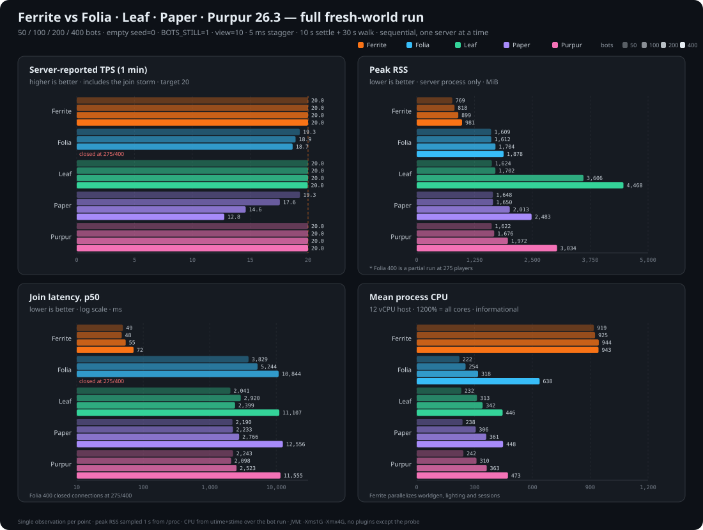
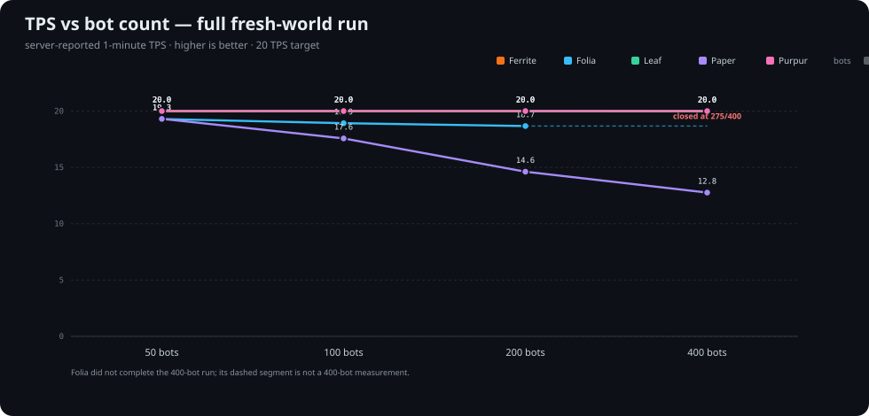

# Ferrite vs Folia · Leaf · Paper · Purpur 26.3 — Full Fresh-World Run (2026-11-23)

This is the complete sequential head-to-head run for 2026-11-23. Ferrite and all four JVM
servers were started from fresh worlds and measured **in this pass**, one at a time. It
supersedes the earlier same-day table, which reused JVM columns from a previous run.

- Ferrite: release binary at `5e76edd2` (`--headless`, Rust worldgen, `.fworld` storage).
- JVM: Folia `26.3-26`, Leaf `26.3-28`, Paper `26.3-259`, Purpur `26.3-2660`, Java 25.0.5.1.

## Workload

- Host: Linux 7.0 x86_64, Intel Xeon Platinum 8358, 12 logical CPUs, 62 GiB RAM.
- Fresh empty world per run, `level-seed=0`, `view-distance=10`, `simulation-distance=10`.
- JVM: `-Xms1G -Xmx4G`, no plugins except the measurement probe. Ferrite:
  `generator = "rust"`, `storage = "fworld"`, `threads = 0`, `lighting-pool = true`,
  16 MiB send queue, no connection burst limit.
- External `examples/bots` client: 50, 100, 200 or 400 bots, `BOTS_STILL=1`,
  `BOTS_VIEW=10`, `BOTS_STAGGER_MS=5`, `BOTS_SETTLE_SECS=10`, 30 s walk.
- A separate 400-bot run walked for 90 s and started its 20 s profile 60 s into the walk.
- One server at a time; each was shut down before the next started. One observation per
  point, so there are no error bars. The 50-bot points were measured in a short second batch
  at 1-minute load `2.8–3.9`; all other points are from the main sequential batch.
- The host was not quiet: the 1-minute load average at the measured run boundaries ranged
  from `2.25` (start) to `12.23` (after the Ferrite batch and early Leaf runs). Raw values
  are in `full-run/schedule.log`.

## Metrics

- **TPS**: the server's own 1-minute figure. JVM is `Bukkit.getTPS()[0]` from the last probe
  sample with all bots online; Ferrite is the `Region 0` 1-minute value. It includes the join
  storm, so it is not a steady-state-only number.
- **Join p50 / p99**: harness-reported time from connect to first position.
- **JVM tick mean / p99**: average of the probe's last ten 1-second samples while the full
  bot count was online. Ferrite `/mspt` reads the coordinator/global tick (0.01–0.33 ms), a
  different quantity, so it is not placed in that row.
- **CPU**: `utime + stime` over the bot-run wall time from `/proc/<pid>/stat`; `1200%` is all
  12 logical CPUs.
- **Peak RSS**: highest `VmRSS` sampled once per second from `/proc/<pid>/status`.

## 50 bots

| Metric | Ferrite | Folia 26.3 | Leaf 26.3 | Paper 26.3 | Purpur 26.3 |
|---|---:|---:|---:|---:|---:|
| **Join `p50` / `p99`** | **49 / 78 ms** | 3,829 / 5,573 ms | 2,041 / 2,200 ms | 2,190 / 2,455 ms | 2,243 / 2,371 ms |
| **Server TPS (1 min)** | **20.0** | 19.3 | **20.0** | 19.3 | **20.0** |
| **JVM tick `mean / p99` (last 10 s)** | —* | 7.9 / 12.1 ms | 6.5 / 9.2 ms | 7.1 / 9.8 ms | 7.3 / 9.9 ms |
| **CPU** | 919% | 222% | 232% | 238% | 242% |
| **Peak RSS** | **769 MiB** | 1,609 MiB | 1,624 MiB | 1,648 MiB | 1,622 MiB |

## 100 bots

| Metric | Ferrite | Folia 26.3 | Leaf 26.3 | Paper 26.3 | Purpur 26.3 |
|---|---:|---:|---:|---:|---:|
| **Join `p50` / `p99`** | **48 / 76 ms** | 5,244 / 10,890 ms | 2,920 / 3,304 ms | 2,233 / 2,460 ms | 2,098 / 2,728 ms |
| **Server TPS (1 min)** | **20.0** | 18.9 | **20.0** | 17.6 | **20.0** |
| **JVM tick `mean / p99` (last 10 s)** | —* | 11.3 / 19.4 ms | 9.9 / 14.3 ms | 10.0 / 14.0 ms | 10.2 / 14.4 ms |
| **CPU** | 925% | 254% | 313% | 306% | 310% |
| **Peak RSS** | **818 MiB** | 1,612 MiB | 1,702 MiB | 1,650 MiB | 1,676 MiB |

## 200 bots

| Metric | Ferrite | Folia 26.3 | Leaf 26.3 | Paper 26.3 | Purpur 26.3 |
|---|---:|---:|---:|---:|---:|
| **Join `p50` / `p99`** | **55 / 93 ms** | 10,844 / 19,542 ms | 2,399 / 11,025 ms | 2,766 / 10,770 ms | 2,523 / 12,466 ms |
| **Server TPS (1 min)** | **20.0** | 18.7 | **20.0** | 14.6 | **20.0** |
| **JVM tick `mean / p99` (last 10 s)** | —* | 21.1 / 31.0 ms | 16.0 / 22.0 ms | 17.9 / 27.7 ms | 18.0 / 23.7 ms |
| **CPU** | 944% | 318% | 342% | 361% | 363% |
| **Peak RSS** | **899 MiB** | 1,704 MiB | 3,606 MiB | 2,013 MiB | 1,972 MiB |

## 400 bots

| Metric | Ferrite | Folia 26.3 | Leaf 26.3 | Paper 26.3 | Purpur 26.3 |
|---|---:|---:|---:|---:|---:|
| **Join `p50` / `p99`** | **72 / 207 ms** | *closed at 275/400†* | 11,107 / 21,115 ms | 12,556 / 26,482 ms | 11,555 / 22,014 ms |
| **Server TPS (1 min)** | **20.0** | —† | **20.0** | 12.8 | **20.0** |
| **JVM tick `mean / p99` (last 10 s)** | —* | —† | 41.9 / 58.7 ms | 45.7 / 62.6 ms | 46.7 / 62.6 ms |
| **CPU** | 943% | 638%† | 446% | 448% | 473% |
| **Peak RSS** | **981 MiB** | 1,878 MiB† | 4,468 MiB | 2,483 MiB | 3,034 MiB |

† Folia did not finish the 400-bot run. The harness reached 275 online players and then
received `server closed the connection`; its CPU and RSS cover that 31.2 s partial run and
are not a 400-bot result. Its last probe sample at 275 players read `15.2 TPS`.

## 400 bots, 90 s sustained (Ferrite)

| Metric | Value |
|---|---:|
| Region 0 TPS (1 min / 5 min) | **20.0 / 20.0** |
| Join `p50` / `p99` | 70 / 270 ms |
| Mean CPU | 744% |
| Peak RSS | 977 MiB |
| Bot-run wall time | 102.5 s |
| Profile (`ms/call`, 20 s after 60 s of walking) | track-entities 5.021, random 3.790, entities 2.307, finish 0.618 |

`region-fluids/advance` did not enter the long run's top-10 profile list.

## Reading the numbers

- **TPS**: Ferrite holds `20.0` at every bot count and in the sustained run. Leaf and Purpur
  also hold `20.0` at 50–400; Paper reports `19.3 / 17.6 / 14.6 / 12.8`; Folia reports
  `19.3 / 18.9 / 18.7` and then closes the 400-bot run at 275 players. This run therefore does
  **not** claim a Ferrite tick-time win over Leaf or Purpur at 400 bots — it shows the same
  TPS with much shorter joins and lower memory.
- **Joins**: Ferrite is `49 / 48 / 55 / 72 ms` median at 50 / 100 / 200 / 400 bots. At 400
  bots that is about **155x** lower than Leaf (11.1 s), **175x** lower than Paper (12.6 s) and
  **161x** lower than Purpur (11.6 s). At 200 bots the advantage is 44x–199x; at 100 bots,
  44x–110x; at 50 bots, 42x–79x.
- **Memory**: Ferrite peaks at `769 / 818 / 899 / 981 MiB`. At 400 bots that is **2.5x–4.6x**
  lower than the completed JVM runs (`2,483–4,468 MiB`); at 50–100 bots it is about half of
  the `1.6–1.7 GiB` JVM figure.
- **CPU**: Ferrite uses `919 / 925 / 944 / 943%` (`744%` in the sustained run), versus
  `222–473%` for the completed JVM runs. This is a throughput-for-latency trade from parallel worldgen,
  lighting and sessions, not a CPU saving.
- **Tick window**: JVM tick time is a last-10-second mean while TPS is a 1-minute figure that
  includes the join storm. The two can disagree: Leaf's 400-bot tick mean is `41.9 ms` with
  `20.0` TPS, while Paper's is `45.7 ms` with `12.8` TPS because its earlier join-storm ticks
  dominate the 1-minute window.

## Limits

- One run per server and bot count, on a host shared with other work (1-minute load
  `2.25–12.23`). Differences smaller than the run-to-run spread of the machine are not
  claimed.
- JVM servers were cold-started for every run, so JIT warm-up is included.
- The bot harness is external; server CPU and RSS do not include the bot processes.
- Folia's 400-bot row is a partial run and must not be read as a 400-player result.

## Reproduction and raw data

The exact runner, parser and chart generator, plus every `meta.txt`, probe `ticks.csv` and
the run schedule, are in [`full-run/`](full-run/). `LOAD_BEFORE` / `LOAD_AFTER` lines in the
raw meta files were written by `uptime -p` and record host uptime, not load; use
`full-run/schedule.log` for the actual 1-minute load at each boundary.

JVM config: `online-mode=false`, `white-list=false`, `allow-nether=false`, `allow-end=false`,
`network-compression-threshold=256`, `sync-chunk-writes=false`. The probe is a single
`JavaPlugin` that samples `Bukkit.getTickTimes()` and `Bukkit.getTPS()[0]` once per second.
Ferrite's world directory was regenerated for each run and every JVM world directory was
fresh as well.
