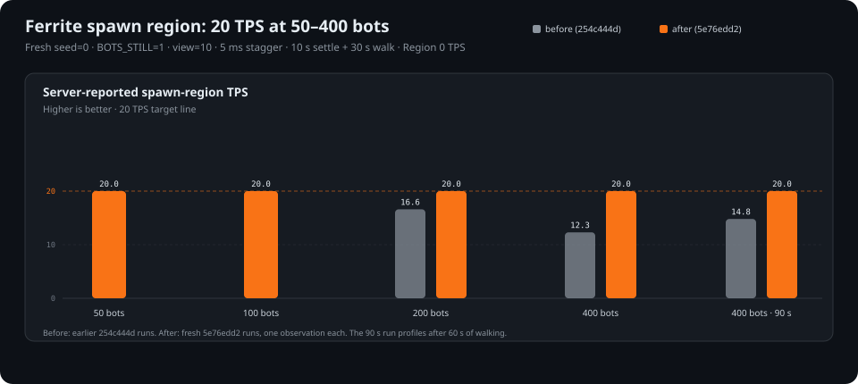

# Ferrite spawn region at 20 TPS — 200/400 bots (2026-11-23)

Follow-up to the [same-day server comparison](server-comparison.md). This run measures the
spawn-region fixes in release commit `70facc94` on the same 12-vCPU host.

## Workload

- Linux 7.0 x86_64, Intel Xeon Platinum 8358, 12 logical CPUs, 62 GiB RAM.
- Ferrite release binary, `--headless`, fresh `seed=0` world, `generator = "rust"`,
  `storage = "fworld"`, `view-distance = 10`, `threads = 0`, `lighting-pool = true`.
- External `examples/bots` client: 200 or 400 bots, `BOTS_STILL=1`, `BOTS_VIEW=10`,
  `BOTS_STAGGER_MS=5`, `BOTS_SETTLE_SECS=10`, 30 s walk. One server at a time.
- TPS is Ferrite's own `Region 0` line, not the coordinator/global tick. Global TPS was
  `20.0` in every run.
- The 60-second run starts its 20-second profile after 60 s of walking; the complete bot
  process ran for 102.3 s.

## Results

| Run | Region 0 TPS (5 s / 1 m / 5 m) | Join p50 / p99 | CPU | Peak RSS | entities | track-entities | fluids/advance | random | finish |
|---|---:|---:|---:|---:|---:|---:|---:|---:|---:|
| 200 bots, 20 s profile | **20.0 / 20.0 / 20.0** | 56 / 95 ms | 933% | 824 MiB | 1.891 ms | 5.554 ms | 11.257 ms | 7.871 ms | 0.629 ms |
| 400 bots, 20 s profile | **20.0 / 20.0 / 20.0** | 74 / 240 ms | 864% | 913 MiB | 4.259 ms | 7.688 ms | 15.489 ms | 9.035 ms | 0.858 ms |
| 400 bots, 60 s + 20 s profile | **20.0 / 20.0 / 20.0** | 84 / 181 ms | 712% | 884 MiB | 2.516 ms | 5.672 ms | —* | 4.823 ms | 0.740 ms |

Per-system values are `ms/call` from the 20-second region profile. CPU is the server process
only, derived from `/proc/<pid>/stat` over the measured wall time. The 400-bot short run
completed 400/400 joins; the bot harness exited `0` in all three runs.

\* `region-fluids/advance` did not enter the long run's top-10 profile list.

## What changed

The dominant long-run regression was not the network or fluid scheduler: natural spawning
used a **per-player** cap. With 400 players sharing one region that allowed 28,000 monsters
and 4,000 animals, and the entity store kept growing until AI and tracking dominated the
region tick.

`ferrite-entity::spawn` now follows vanilla `SpawnState`: the category cap is scaled by the
number of spawnable chunks divided by `17 × 17`, not by the number of players viewing those
chunks. The region passes its loaded chunk count; the old per-player wrapper remains for
callers without a chunk inventory.

The earlier hot-path changes are also included in `70facc94`:

- viewer-batched tracker, fluid and random-tick block updates through `Outbound::Batch`;
- a fast path for stable source water surrounded by source water;
- synthetic spawn-cap tests, including the `289`-chunk scale.

## Before / after

| Workload | Before | After |
|---|---:|---:|
| 200 bots, spawn Region 0 | 16.6 TPS | **20.0 TPS** |
| 400 bots, spawn Region 0 | 12.3 TPS | **20.0 TPS** |
| 400 bots, 60 s sustained | 14.8 TPS | **20.0 TPS** |

Before values are the `254c444d` runs in [server-comparison.md](server-comparison.md) and the
previous uncommitted optimization profile on the same host. They are single observations and
the host was not quiet.

## Same-day server comparison

The JVM columns below are the earlier same-day runs from
[server-comparison.md](server-comparison.md), not a fresh rerun in this pass. They are kept
here because the Ferrite workload and host are identical.

| 200 bots | Ferrite | Folia | Leaf | Paper | Purpur |
|---|---:|---:|---:|---:|---:|
| Spawn/server TPS | **20.0** | 16.4 | **20.0** | 14.5 | **20.0** |
| Join p50 | **56 ms** | 11,802 ms | 2,345 ms | 2,568 ms | 4,714 ms |
| Peak RSS | **824 MiB** | 1,730 MiB | 3,666 MiB | 2,429 MiB | 1,860 MiB |

| 400 bots | Ferrite | Folia | Leaf | Paper | Purpur |
|---|---:|---:|---:|---:|---:|
| Spawn/server TPS | **20.0** | —† | **20.0** | 10.6 | **20.0** |
| Join p50 | **74 ms** | —† | 8,711 ms | 13,432 ms | 15,620 ms |
| Peak RSS | **913 MiB** | —† | 4,547 MiB | 2,507 MiB | 2,558 MiB |

† Folia closed connections at 262/400 in the earlier run; no 400-bot TPS is claimed.

Ferrite now holds the same `20.0` spawn-region TPS as Leaf and Purpur at 400 bots, while
retaining the lower join latency and RSS measured in the same workload. Paper's 400-bot run
reported `10.6`. The Ferrite CPU cost remains high (`864%` at 400 bots) because world
generation, lighting and sessions are parallelized; this is not a CPU-saving claim.

## Reproduction

The benchmark used the repository's external bot harness with the options above. The exact
logs for this pass are local artifacts under `/tmp/ferrite-ab-2026-11-23/runs/` and are not
committed. The world and bot counts were regenerated for each run.

