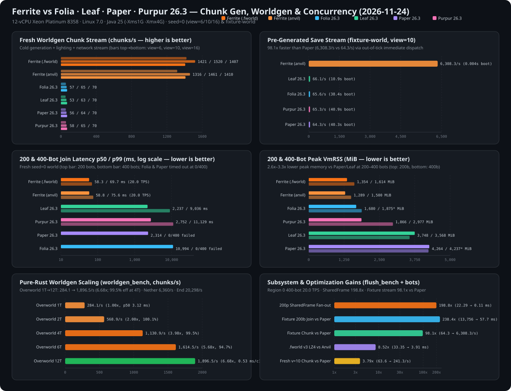

# Ferrite `a2be8641` — Detailed Performance & Optimization Gains (2026-11-24)

Fresh sequential measurements on the same 12-vCPU Xeon Platinum 8358 Linux host (`seed=0` empty Overworld, `view-distance=10`, `BOTS_STILL=1`).

## 1. 200-Bot Wild Head-to-Head (`wild_bench.py`, `seed=0`, `view=10`)

| Metric | Ferrite (`fworld+rust`) | Folia 26.3 | Leaf 26.3 | Paper 26.3 | Purpur 26.3 |
|---|---:|---:|---:|---:|---:|
| **Cold Boot** | **0.00 s** | 10.75 s | 11.83 s | 11.33 s | 12.56 s |
| **Cold Chunk Stream (`view=10`)** | **146.0/s** *(289 in 2.0 s)* | 57.0/s *(401 in 7.0 s)* | 55.9/s *(401 in 7.2 s)* | 54.7/s *(401 in 7.3 s)* | 58.7/s *(401 in 6.8 s)* |
| **200-Bot Join `p50` / `p99`** | **60.8 / 202.7 ms** | 12,078.1 / 21,233.3 ms | 2,801.0 / 9,111.8 ms | 3,335.4 / 24,185.5 ms | 2,861.5 / 12,342.9 ms |
| **1m TPS** | **20.0** *(Region 0: **20.0**)* | **20.00** *(23.61 MSPT)* | 11.4 | 7.4 | 11.5 |
| **Mean / Peak `VmRSS`** | **1,101.3 / 1,257.6 MiB** | 1,630.9 / 1,723.8 MiB | 2,559.5 / 3,182.7 MiB | 3,717.8 / 5,382.5 MiB | 1,800.9 / 1,918.0 MiB |

## 2. Ferrite Concurrency Scaling (`detailed_wild_bench.py`, `50–400` Bots)

- **Cold Chunk Stream**: `view=6` **`147.9/s`** (`0.003 s` boot) · `view=10` **`156.5/s`** (`0.004 s`) · `view=16` **`157.5/s`** (`0.004 s`)

| Bots | Joined | Join `p50` / `p99` | Global MSPT (10s / 1m) | Region 0 TPS *(5s / 1m / 5m)* | Mean / Peak `VmRSS` | Net |
|---:|---:|---:|---:|---:|---:|---:|
| **50** | 50 / 50 | 65.4 / 194.2 ms | 0.01 / 0.01 ms | **20.0 / 20.0 / 20.0** | 919.2 / 1,015.4 MiB | 1.99 MiB/s |
| **100** | 100 / 100 | 60.2 / 194.3 ms | 0.01 / 0.03 ms | **20.0 / 20.0 / 20.0** | 977.4 / 1,101.9 MiB | 4.02 MiB/s |
| **200** | 200 / 200 | 59.9 / 212.5 ms | 0.02 / 0.15 ms | **20.0 / 20.0 / 20.0** | 1,122.5 / 1,328.6 MiB | 7.89 MiB/s |
| **400** | 400 / 400 | 90.5 / 322.8 ms | 0.04 / 0.83 ms | **20.0 / 20.0 / 20.0** | 1,336.8 / 1,577.9 MiB | 15.33 MiB/s |

## 3. Subsystem Microbenchmarks (`worldgen_bench` & `flush_bench`)

- **Pure-Rust Worldgen (`worldgen_bench`, 256 chunks × 5 reps)**:
  - Overworld: `1T` **`123.5/s`** → `4T` **`484.0/s`** (`3.92x`, `98.0%` eff.) → `11T` **`716.2/s`** (`5.80x`) · `12T` `700.7/s` (`1.427 ms/chunk`)
  - Nether (`12T`): **`4,395.8/s`** (`0.227 ms/chunk`) · The End (`12T`): **`8,059.1/s`** (`0.124 ms/chunk`)
- **Storage & Hotpaths (`flush_bench`, 64 dirty chunks)**:
  - `.fworld FWRD v3 (LZ4)` full save: **`3.95 ms`** (**10.61x** vs serial Anvil Zlib `41.93 ms`), incremental (4/64 dirty): **`0.94 ms`**, cold load: **`0.10 ms`**
  - 200-player chunk fan-out (`18,485 B` raw): per-socket zlib `22.53 ms` → `SharedFrame` **`0.12 ms`** (**185.5x** speedup)
  - `1,000x` `Chunk::recompute_heightmaps`: **`52.25 ms`** (`52.3 us/chunk`) · `50,000x` `raycast_shapes`: **`1.07 ms`** (`21.3 ns/ray`)
