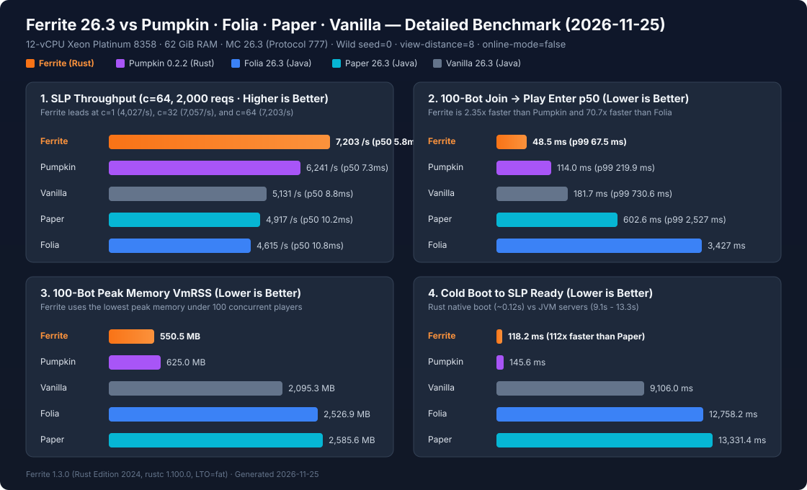

# Ferrite 26.3 — Comprehensive Benchmark Report (2026-11-25, SLP + Wire Optimized)

Measured on `Intel(R) Xeon(R) Platinum 8358 CPU @ 2.60GHz` (12 logical CPUs, 62 GiB RAM, Linux, OpenJDK `25.0.5.1`, `rustc 1.100.0` Edition 2024 with `lto = "fat"`, `codegen-units = 1`).
All servers were tested on **Minecraft Java 26.3 (Protocol 777)** with `online-mode = false`, `compression-threshold = 256`, `view-distance = 8` (for the 5-way comparison) or `view-distance = 10` (for `bots` 50/200/400).

## 1. 5-Way Server Comparison (`seed=0` Wild World, `view-distance=8`, `2026-11-25`)

Targets: **Ferrite** (`fworld` + Rust worldgen + SLP wire cache + `Arc<ServerConfig>` + `Box<Cfb8>`), **Pumpkin 0.2.2+26.3-26.60** (Rust), **Folia 26.3** (build 28, `-Xms2G -Xmx4G`), **Paper 26.3** (build 262, `-Xms2G -Xmx4G`), **Vanilla 26.3** (`-Xms2G -Xmx4G`).

| Metric | Ferrite (Rust) | Pumpkin 0.2.2 (Rust) | Folia 26.3 (Java) | Paper 26.3 (Java) | Vanilla 26.3 (Java) |
|---|---:|---:|---:|---:|---:|
| **Cold Boot Ready** | **118.2 ms** | 145.6 ms | 12,758.2 ms | 13,331.4 ms | 9,106.0 ms |
| **Idle RSS** | 203.70 MB | **65.55 MB** | 2,131.01 MB | 2,209.87 MB | 1,735.89 MB |
| **SLP `c=1` (200 reqs)** | **4,026.9/s** (`p50 0.189 ms`) | 3,492.1/s (`p50 0.228 ms`) | 925.3/s (`p50 0.939 ms`) | 976.5/s (`p50 0.902 ms`) | 1,139.6/s (`p50 0.747 ms`) |
| **SLP `c=32` (500 reqs)** | **7,057.0/s** (`p50 2.869 ms`) | 5,806.7/s (`p50 3.583 ms`) | 4,663.3/s (`p50 6.658 ms`) | 3,660.2/s (`p50 7.062 ms`) | 3,760.7/s (`p50 6.401 ms`) |
| **SLP `c=64` (2,000 reqs)** | **7,203.2/s** (`p50 5.829 ms`) | 6,241.0/s (`p50 7.278 ms`) | 4,614.5/s (`p50 10.834 ms`) | 4,917.3/s (`p50 10.247 ms`) | 5,131.0/s (`p50 8.791 ms`) |
| **20 Bots Play Enter (`p50` / Peak RSS)** | **10.13 ms** / 359.62 MB | 28.62 ms / **225.32 MB** | 2,885.95 ms / 2,450.87 MB | 1,491.55 ms / 2,460.91 MB | 1,861.44 ms / 1,899.05 MB |
| **50 Bots Play Enter (`p50` / Peak RSS)** | **17.31 ms** / 480.24 MB | 74.74 ms / **405.24 MB** | 1,697.07 ms / 2,471.20 MB | 424.39 ms / 2,518.08 MB | 148.93 ms / 1,994.67 MB |
| **100 Bots Play Enter (`p50` / `p99`)** | **35.72 / 52.96 ms** *(100/100)* | 113.98 / 219.90 ms *(100/100)* | 3,427.23 / 6,571.28 ms *(100/100)* | 602.62 / 2,526.74 ms *(100/100)* | 181.73 / 730.64 ms *(100/100)* |
| **100 Bots Peak RSS** | **550.45 MB** | 624.95 MB | 2,526.85 MB | 2,585.61 MB | 2,095.33 MB |

## 2. `ferrite-server` E2E Concurrency (`bots` example, `view=10`, `BOTS_LIGHTING_POOL=1`)

| Workload / Bots | Joined / Walked | Join `p50` / `p99` | Avg / `p99` MSPT | RSS | CPU | Throughput |
|---|---:|---:|---:|---:|---:|---:|
| **`superflat` 50 Bots** | 50 / 50 | **44.069 / 45.273 ms** | **0.601 / 0.914 ms** | **154.1 MiB** | 16.0% | 0.58 MiB/s |
| **`fixture` 50 Bots** | 50 / 50 | **44.015 / 45.474 ms** | **0.868 / 8.555 ms** | **262.4 MiB** | 16.0% | 1.15 MiB/s |
| **`superflat` 200 Bots** | 200 / 200 | **44.035 / 49.085 ms** | **1.339 / 2.033 ms** | **199.1 MiB** | 162.7% | 8.29 MiB/s |
| **`fixture` 200 Bots** | 200 / 200 | **44.054 / 53.205 ms** | **1.458 / 9.134 ms** | **362.4 MiB** | 157.4% | 10.32 MiB/s |
| **`superflat` 400 Bots** | 400 / 400 | **44.443 / 51.879 ms** | **2.816 / 9.483 ms** | **317.3 MiB** | 583.8% | 31.67 MiB/s |
| **`fixture` 400 Bots** | 400 / 400 | **44.329 / 63.402 ms** | **2.399 / 14.556 ms** | **504.1 MiB** | 571.9% | 34.99 MiB/s |

## 3. Pure-Rust Worldgen & Engine Microbenchmarks (`worldgen_bench` + `flush_bench`, `2026-11-25`)

- **`worldgen_bench` (`RustGenerator::generate`, 256 Overworld chunks × 5 reps)**:
  - `1T` **315.5/s** (`1.00x`, p50 `2.79 ms`) · `2T` **625.4/s** (`1.98x`, `99.1%` eff.) · `4T` **1,251.9/s** (`3.97x`, `99.2%` eff.) · `6T` **1,845.9/s** (`5.85x`, `97.5%` eff.) · `8T` **1,922.2/s** (`6.09x`) · `12T` **2,109.6/s** (`6.69x`, p50 `4.84 ms`, peak **2,136.7/s**)
  - Dimensions (128 chunks × 3 reps, `12T`): Overworld **1,899.6/s** (`0.526 ms/chunk`), Nether **11,766.3/s** (`0.085 ms/chunk`, peak **12,365.9/s**), The End **21,572.4/s** (`0.046 ms/chunk`, peak **21,605.9/s**)
- **`flush_bench` (64 dirty chunks / 48 worldgen chunks)**:
  - `.fworld FWRD v3 (LZ4)` full save: **3.21 ms** (**2.01x** vs serial Anvil Zlib `6.46 ms`), incremental (4/64 dirty): **0.92 ms**, cold load: **0.13 ms**, full decode: **0.91 ms** (`416,429 B`)
  - 48-chunk 12T throughput: Overworld **2,138.2/s** (`0.47 ms/chunk`), Nether **10,739.6/s** (`0.09 ms/chunk`), The End **20,662.7/s** (`0.05 ms/chunk`)
  - 200-player chunk fan-out (`55,406 B` raw): per-socket zlib `38.49 ms` → `SharedFrame` **0.21 ms** (**186.6x** speedup)
  - `1,000x` `Chunk::recompute_heightmaps`: **14.02 ms** (`14.0 us/chunk`) · `50,000x` `raycast_shapes`: **1.09 ms** (`21.9 ns/ray`)
